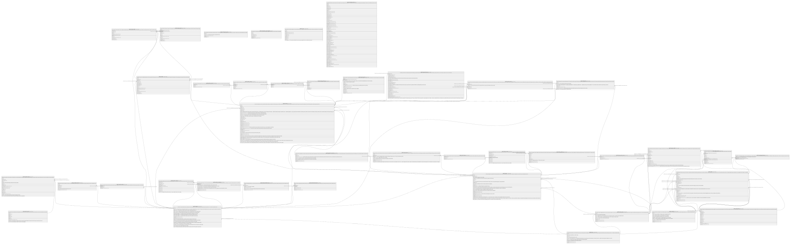

# postgres

## Tables

| Name                                                                | Columns | Comment                                                                                                                                                                                                                                                                                                                                                                                          | Type       |
| ------------------------------------------------------------------- | ------- | ------------------------------------------------------------------------------------------------------------------------------------------------------------------------------------------------------------------------------------------------------------------------------------------------------------------------------------------------------------------------------------------------ | ---------- |
| [public.providers](public.providers.md)                             | 18      | A business or host that sells Services or Experiences. One per login (owner_id is unique). Never deleted: bookings and payouts will point here, so a provider is suspended instead.                                                                                                                                                                                                              | BASE TABLE |
| [public.cities](public.cities.md)                                   | 9       | The markets lokl operates in, each named after its main city and covering its metro area (Atlanta covers Decatur, Marietta and so on). Admin-managed. Never deleted: providers and listings point here, so a market is deactivated instead.                                                                                                                                                      | BASE TABLE |
| [public.service_areas](public.service_areas.md)                     | 8       | Areas within a market: neighborhoods, cities or towns, and zip codes. Where "I come to you" Services travel, and the public location label on listings. Admin-managed. Never deleted: listings will point here, so an area is deactivated instead.                                                                                                                                               | BASE TABLE |
| [public.categories](public.categories.md)                           | 9       | Service and Experience categories. Flat and admin-managed; each listing belongs to one category of its own kind. Never deleted: listings will point here, so a category is deactivated instead.                                                                                                                                                                                                  | BASE TABLE |
| [public.listings](public.listings.md)                               | 23      | A Service or Experience a provider offers. Deleted only while it has never been live (published_at is null); after that it is unlisted or unpublished, never deleted, because bookings will point at it.                                                                                                                                                                                         | BASE TABLE |
| [public.listing_addresses](public.listing_addresses.md)             | 9       | A listing's exact address. Private: readable only by the listing's provider and the admin (customers with a confirmed booking come later). Required for provider-location Services and Experiences before publishing or submitting. Deleted with its listing, or by the provider when it is no longer needed.                                                                                    | BASE TABLE |
| [public.listing_service_areas](public.listing_service_areas.md)     | 3       | Where an "I come to you" Service travels. At least one row is required before a customer-location Service can go live. Rows go with their listing; the provider removes a row to stop covering an area.                                                                                                                                                                                          | BASE TABLE |
| [public.listing_photos](public.listing_photos.md)                   | 8       | Photos of a listing, at most 8. Position 0 is the cover. At least one is required before a listing is published or submitted. Removed by the provider (not while submitted or unpublished, and never the last one of a live listing) or by the admin; rows go with their listing. Removing a row leaves the stored file.                                                                         | BASE TABLE |
| [public.experience_sessions](public.experience_sessions.md)         | 7       | Dated sessions of an Experience, each with a number of spots. Providers add and change future sessions (not while the listing is submitted or unpublished); a session that has started is kept as it is. Deleted with their listing, or by the provider before they start; once bookings exist, a session with bookings is cancelled instead.                                                    | BASE TABLE |
| [public.notifications](public.notifications.md)                     | 7       | Things that happened to a provider's listings because of an admin action. Written only by the listings_notify_status_change trigger. Providers read their own and mark them read. Deleted with their listing; otherwise kept (a cleanup of old read ones comes later).                                                                                                                           | BASE TABLE |
| [public.commission_rates](public.commission_rates.md)               | 4       | lokl's commission per kind of listing, in basis points (1200 = 12%). Admin-editable. Each booking copies the rate in force when it's created, so changes never touch past bookings. Never deleted.                                                                                                                                                                                               | BASE TABLE |
| [public.bookings](public.bookings.md)                               | 36      | A customer's booking of a Service (a request the provider accepts) or an Experience session (paid at once). Written only by the website's server. lokl holds the payment and transfers the provider's share 24 hours after the booking ends. Never deleted: payments, refunds and payouts point here.                                                                                            | BASE TABLE |
| [public.booking_events](public.booking_events.md)                   | 6       | Every status change of a booking: from, to, who (customer, provider, admin, system, stripe) and when. Written by a trigger. Never changed or deleted.                                                                                                                                                                                                                                            | BASE TABLE |
| [public.booking_contacts](public.booking_contacts.md)               | 3       | The customer's email and optional phone for a booking. The provider reads them only once the booking is accepted or confirmed. Never deleted.                                                                                                                                                                                                                                                    | BASE TABLE |
| [public.booking_addresses](public.booking_addresses.md)             | 7       | Where an "I come to you" Service takes place: the customer's address. The provider reads it only once the booking is accepted. Never deleted.                                                                                                                                                                                                                                                    | BASE TABLE |
| [public.booking_emails](public.booking_emails.md)                   | 14      | Booking emails to send and what happened to each (the outbox and the log). Filled by triggers on bookings; sent by the website's server. Server only; admins can read. Never deleted.                                                                                                                                                                                                            | BASE TABLE |
| [public.admin_actions](public.admin_actions.md)                     | 9       | Every admin action on bookings, emails and providers: who, what, when and why. Written by the website's admin routes with the service role; read by admins. Never deleted.                                                                                                                                                                                                                       | BASE TABLE |
| [public.commission_rate_changes](public.commission_rate_changes.md) | 6       | Each change to a commission rate: from, to, who and when. Filled by a trigger on commission_rates; read by admins. Never deleted.                                                                                                                                                                                                                                                                | BASE TABLE |
| [public.job_runs](public.job_runs.md)                               | 10      | Each timed job run (website /api/jobs/*): how many bookings it looked at, changed and couldn't handle, with the failures. Written by the website's server; read by admins.                                                                                                                                                                                                                       | BASE TABLE |
| [public.provider_emails](public.provider_emails.md)                 | 17      | Emails about a provider's account (paused, active again) to send, and what happened to each. One per admin action. Queued by admin_set_provider_status(); sent by the website's server. Server only; admins can read. Never deleted.                                                                                                                                                             | BASE TABLE |
| [public.booking_finances](public.booking_finances.md)               | 23      | A booking's money side: the commission split (copied at booking), payout holds and failures, Stripe ids, dispute and reversal details. Read by the booking's provider and admins, never the customer; written by the server. Never deleted.                                                                                                                                                      | BASE TABLE |
| [public.booking_reports](public.booking_reports.md)                 | 3       | The customer's "the provider didn't show up" note. Read by that customer and admins, never the provider; written by the server; final once written. Never deleted.                                                                                                                                                                                                                               | BASE TABLE |
| [private.booking_records](private.booking_records.md)               | 56      | A booking with its finances and no-show note, for the website's server only (service role). Updatable: one statement writes booking_finances, booking_reports and bookings, in that order, so the booking's rules see the money.                                                                                                                                                                 | VIEW       |
| [public.guides](public.guides.md)                                   | 26      | Destination guides: articles about a place or theme in a market that recommend live lokl listings. Admin-written. Draft columns are edited; live columns (title, teaser, body, cover_photo_id) are set only by publish_guide(). Visitors see published guides through the website's server. Unpublished, never deleted, once published.                                                          | BASE TABLE |
| [public.guide_photos](public.guide_photos.md)                       | 14      | Photos of a guide, in the public guide-photos bucket under <guide id>/: resized in the browser (longest side at most 2,400px, metadata removed), with a ~600px card copy. Credits as the licence asks: none for own photos; "Photo by {name} on Unsplash" with links; or the credit, licence and source for another licence (commercial use confirmed).                                          | BASE TABLE |
| [public.guide_versions](public.guide_versions.md)                   | 11      | A snapshot of a guide's live copy each time it's published, with who and when. Written by publish_guide(); read by admins.                                                                                                                                                                                                                                                                       | BASE TABLE |
| [public.guide_ai_drafts](public.guide_ai_drafts.md)                 | 16      | Every AI draft request: what was sent (topic, area, category, the admin's notes), the model, the reply or error, tokens and cost, who and when. Written by the admin app's server; read by admins. Kept if its guide is deleted (the cost log).                                                                                                                                                  | BASE TABLE |
| [public.homepage_features](public.homepage_features.md)             | 3       | The guides on the homepage: position 1 is the main guide (the hero), 2 and 3 the guides section's cards. Chosen by the admin; only published guides. Unpublishing or deleting a guide removes it; without a main guide, the cards aren't shown.                                                                                                                                                  | BASE TABLE |
| [public.saved_listings](public.saved_listings.md)                   | 3       | Listings a customer saved (their "Saved" list). Private to that customer: nobody else can read it, not even the listing's provider or admins. Deleted with the customer's login or the listing.                                                                                                                                                                                                  | BASE TABLE |
| [public.saved_providers](public.saved_providers.md)                 | 3       | Providers a customer saved (their "Saved" list). Private to that customer: nobody else can read it, not even the provider or admins. Deleted with the customer's login; providers are never deleted.                                                                                                                                                                                             | BASE TABLE |
| [public.reviews](public.reviews.md)                                 | 15      | A customer's review of a completed booking: one to five stars and their words, public at once. One per booking. Deleted only by its customer within 14 days of the booking's end; removed (status) only by an admin, under the written rules.                                                                                                                                                    | BASE TABLE |
| [public.review_replies](public.review_replies.md)                   | 9       | The provider's one public reply to a review. Editable and deletable by them at any time (deleting is also how a removed reply is written again); removed (status) only by an admin. Goes with its review.                                                                                                                                                                                        | BASE TABLE |
| [public.review_reports](public.review_reports.md)                   | 11      | A signed-in person's report that a review or its reply breaks a written rule, for the admin's queue. One per person per review and target. Goes with its review (or the reporter's login).                                                                                                                                                                                                       | BASE TABLE |
| [public.listing_ratings](public.listing_ratings.md)                 | 10      | Each listing's published reviews: count, star total and average (rounded half up to one decimal). Kept by the reviews_recount trigger; never written from the apps.                                                                                                                                                                                                                              | BASE TABLE |
| [public.provider_ratings](public.provider_ratings.md)               | 10      | Each provider's published reviews across all their listings (including ones no longer live): count, star total and average. Kept by the reviews_recount trigger.                                                                                                                                                                                                                                 | BASE TABLE |
| [public.provider_schedules](public.provider_schedules.md)           | 7       | A provider's booking settings, one row per provider (defaults apply without one). The provider writes it; deleting it goes back to the defaults. Goes with its provider (providers are never deleted).                                                                                                                                                                                           | BASE TABLE |
| [public.provider_weekly_hours](public.provider_weekly_hours.md)     | 6       | A provider's repeating weekly hours: one row per interval (a day can have several). Wall-clock times in the market's time zone. The provider adds, changes and deletes them freely; nothing points here.                                                                                                                                                                                         | BASE TABLE |
| [public.provider_date_hours](public.provider_date_hours.md)         | 6       | Hours for one date, replacing that weekday's weekly hours: one row per interval. A day off is time off for that date. The provider adds, changes and deletes them freely; nothing points here.                                                                                                                                                                                                   | BASE TABLE |
| [public.provider_time_off](public.provider_time_off.md)             | 6       | Whole days a provider isn't available, from starts_on to ends_on (inclusive), whatever their hours. The provider adds, changes and deletes them freely; nothing points here.                                                                                                                                                                                                                     | BASE TABLE |
| [public.provider_holds](public.provider_holds.md)                   | 6       | The provider's time each Service booking (from a slot) and each scheduled Experience session takes: [start, end + buffer). No two of a provider's holds overlap, across all their listings. Written only by triggers on bookings and experience_sessions; deleted when the booking is released (expired, declined, cancelled) or the session cancelled or deleted. Not readable through the API. | BASE TABLE |

## Stored procedures and functions

| Name                                         | ReturnType    | Arguments                                                                                                                                                                                                                                                                                                                                                                                                                                                                           | Type     |
| -------------------------------------------- | ------------- | ----------------------------------------------------------------------------------------------------------------------------------------------------------------------------------------------------------------------------------------------------------------------------------------------------------------------------------------------------------------------------------------------------------------------------------------------------------------------------------- | -------- |
| public.is_admin                              | bool          |                                                                                                                                                                                                                                                                                                                                                                                                                                                                                     | FUNCTION |
| public.set_updated_at                        | trigger       |                                                                                                                                                                                                                                                                                                                                                                                                                                                                                     | FUNCTION |
| public.providers_check_city_active           | trigger       |                                                                                                                                                                                                                                                                                                                                                                                                                                                                                     | FUNCTION |
| public.current_provider_id                   | uuid          |                                                                                                                                                                                                                                                                                                                                                                                                                                                                                     | FUNCTION |
| public.listing_parents_active                | bool          | p_provider_id uuid, p_category_id uuid, p_city_id uuid                                                                                                                                                                                                                                                                                                                                                                                                                              | FUNCTION |
| public.listings_set_slug                     | trigger       |                                                                                                                                                                                                                                                                                                                                                                                                                                                                                     | FUNCTION |
| public.listings_check_references             | trigger       |                                                                                                                                                                                                                                                                                                                                                                                                                                                                                     | FUNCTION |
| public.listings_guard_provider_edits         | trigger       |                                                                                                                                                                                                                                                                                                                                                                                                                                                                                     | FUNCTION |
| public.listing_service_areas_check           | trigger       |                                                                                                                                                                                                                                                                                                                                                                                                                                                                                     | FUNCTION |
| public.listing_addresses_guard               | trigger       |                                                                                                                                                                                                                                                                                                                                                                                                                                                                                     | FUNCTION |
| public.listing_service_areas_guard           | trigger       |                                                                                                                                                                                                                                                                                                                                                                                                                                                                                     | FUNCTION |
| public.listing_photos_check                  | trigger       |                                                                                                                                                                                                                                                                                                                                                                                                                                                                                     | FUNCTION |
| public.listing_photos_guard                  | trigger       |                                                                                                                                                                                                                                                                                                                                                                                                                                                                                     | FUNCTION |
| public.listings_require_photo                | trigger       |                                                                                                                                                                                                                                                                                                                                                                                                                                                                                     | FUNCTION |
| public.reorder_listing_photos                | void          | p_listing_id uuid, p_photo_ids uuid[]                                                                                                                                                                                                                                                                                                                                                                                                                                               | FUNCTION |
| public.experience_sessions_check             | trigger       |                                                                                                                                                                                                                                                                                                                                                                                                                                                                                     | FUNCTION |
| public.experience_sessions_guard             | trigger       |                                                                                                                                                                                                                                                                                                                                                                                                                                                                                     | FUNCTION |
| public.listings_notify_status_change         | trigger       |                                                                                                                                                                                                                                                                                                                                                                                                                                                                                     | FUNCTION |
| public.notifications_set_read_at             | trigger       |                                                                                                                                                                                                                                                                                                                                                                                                                                                                                     | FUNCTION |
| public.providers_owner_not_admin             | trigger       |                                                                                                                                                                                                                                                                                                                                                                                                                                                                                     | FUNCTION |
| public.commission_rates_stamp                | trigger       |                                                                                                                                                                                                                                                                                                                                                                                                                                                                                     | FUNCTION |
| public.bookings_guard                        | trigger       |                                                                                                                                                                                                                                                                                                                                                                                                                                                                                     | FUNCTION |
| public.bookings_log_status                   | trigger       |                                                                                                                                                                                                                                                                                                                                                                                                                                                                                     | FUNCTION |
| public.session_spots_taken                   | int4          | p_session_id uuid                                                                                                                                                                                                                                                                                                                                                                                                                                                                   | FUNCTION |
| public.session_spots_left                    | int4          | p_session_id uuid                                                                                                                                                                                                                                                                                                                                                                                                                                                                   | FUNCTION |
| public.booking_money                         | record        | p_kind text, p_unit_price integer, p_party smallint, OUT total integer, OUT rate integer, OUT commission integer, OUT provider_amount integer                                                                                                                                                                                                                                                                                                                                       | FUNCTION |
| public.experience_sessions_booked_guard      | trigger       |                                                                                                                                                                                                                                                                                                                                                                                                                                                                                     | FUNCTION |
| public.bookings_notify_provider              | trigger       |                                                                                                                                                                                                                                                                                                                                                                                                                                                                                     | FUNCTION |
| public.bookings_notify_problem               | trigger       |                                                                                                                                                                                                                                                                                                                                                                                                                                                                                     | FUNCTION |
| public.booking_emails_queue                  | void          | p_booking_id uuid, p_kinds text[]                                                                                                                                                                                                                                                                                                                                                                                                                                                   | FUNCTION |
| public.bookings_queue_emails                 | trigger       |                                                                                                                                                                                                                                                                                                                                                                                                                                                                                     | FUNCTION |
| public.commission_rates_log_change           | trigger       |                                                                                                                                                                                                                                                                                                                                                                                                                                                                                     | FUNCTION |
| public.admin_set_provider_status             | bool          | p_provider_id uuid, p_status text, p_admin_id uuid, p_reason text, p_message text                                                                                                                                                                                                                                                                                                                                                                                                   | FUNCTION |
| public.booking_finances_guard                | trigger       |                                                                                                                                                                                                                                                                                                                                                                                                                                                                                     | FUNCTION |
| public.booking_reports_final                 | trigger       |                                                                                                                                                                                                                                                                                                                                                                                                                                                                                     | FUNCTION |
| public.booking_finances_queue_emails         | trigger       |                                                                                                                                                                                                                                                                                                                                                                                                                                                                                     | FUNCTION |
| private.booking_records_update               | trigger       |                                                                                                                                                                                                                                                                                                                                                                                                                                                                                     | FUNCTION |
| public.bookings_clear_hold_when_refunded     | trigger       |                                                                                                                                                                                                                                                                                                                                                                                                                                                                                     | FUNCTION |
| public.guide_photos_in_own_folder            | trigger       |                                                                                                                                                                                                                                                                                                                                                                                                                                                                                     | FUNCTION |
| public.guides_cover_is_own                   | trigger       |                                                                                                                                                                                                                                                                                                                                                                                                                                                                                     | FUNCTION |
| public.guides_area_in_market                 | trigger       |                                                                                                                                                                                                                                                                                                                                                                                                                                                                                     | FUNCTION |
| public.guides_guard                          | trigger       |                                                                                                                                                                                                                                                                                                                                                                                                                                                                                     | FUNCTION |
| public.homepage_features_published_only      | trigger       |                                                                                                                                                                                                                                                                                                                                                                                                                                                                                     | FUNCTION |
| public.publish_guide                         | void          | p_guide_id uuid, p_admin_id uuid                                                                                                                                                                                                                                                                                                                                                                                                                                                    | FUNCTION |
| public.unpublish_guide                       | void          | p_guide_id uuid, p_admin_id uuid                                                                                                                                                                                                                                                                                                                                                                                                                                                    | FUNCTION |
| public.provider_payout_setup                 | text          | p_account_id text, p_charges boolean, p_payouts boolean                                                                                                                                                                                                                                                                                                                                                                                                                             | FUNCTION |
| public.admin_search_patterns                 | _text         | p_q text                                                                                                                                                                                                                                                                                                                                                                                                                                                                            | FUNCTION |
| public.admin_listings_page                   | jsonb         | p_kind text, p_q text DEFAULT NULL::text, p_status text DEFAULT NULL::text, p_city_id uuid DEFAULT NULL::uuid, p_provider_id uuid DEFAULT NULL::uuid, p_sort text DEFAULT 'updated'::text, p_desc boolean DEFAULT true, p_page integer DEFAULT 1, p_page_size integer DEFAULT 25                                                                                                                                                                                                    | FUNCTION |
| public.public_guide_photo_json               | jsonb         | p guide_photos                                                                                                                                                                                                                                                                                                                                                                                                                                                                      | FUNCTION |
| public.public_guides                         | jsonb         | p_market text                                                                                                                                                                                                                                                                                                                                                                                                                                                                       | FUNCTION |
| public.public_guide                          | jsonb         | p_market text, p_slug text                                                                                                                                                                                                                                                                                                                                                                                                                                                          | FUNCTION |
| public.public_homepage_guides                | jsonb         |                                                                                                                                                                                                                                                                                                                                                                                                                                                                                     | FUNCTION |
| public.admin_set_homepage_features           | void          | p_guide_ids uuid[]                                                                                                                                                                                                                                                                                                                                                                                                                                                                  | FUNCTION |
| public.booking_finances_released_only_grows  | trigger       |                                                                                                                                                                                                                                                                                                                                                                                                                                                                                     | FUNCTION |
| public.admin_bookings_page                   | jsonb         | p_q text DEFAULT NULL::text, p_status text DEFAULT NULL::text, p_kind text DEFAULT NULL::text, p_provider_id uuid DEFAULT NULL::uuid, p_from date DEFAULT NULL::date, p_to date DEFAULT NULL::date, p_attention text DEFAULT NULL::text, p_sort text DEFAULT 'created'::text, p_desc boolean DEFAULT true, p_page integer DEFAULT 1, p_page_size integer DEFAULT 25, p_with_attention boolean DEFAULT false, p_paid_from date DEFAULT NULL::date, p_paid_to date DEFAULT NULL::date | FUNCTION |
| public.admin_providers_page                  | jsonb         | p_q text DEFAULT NULL::text, p_status text DEFAULT NULL::text, p_payout_setup text DEFAULT NULL::text, p_city_id uuid DEFAULT NULL::uuid, p_sort text DEFAULT 'joined'::text, p_desc boolean DEFAULT true, p_page integer DEFAULT 1, p_page_size integer DEFAULT 25, p_paid_since date DEFAULT NULL::date                                                                                                                                                                           | FUNCTION |
| public.admin_dashboard                       | jsonb         |                                                                                                                                                                                                                                                                                                                                                                                                                                                                                     | FUNCTION |
| public.has_contact_details                   | bool          | p_text text                                                                                                                                                                                                                                                                                                                                                                                                                                                                         | FUNCTION |
| public.provider_slug                         | text          | p_name text                                                                                                                                                                                                                                                                                                                                                                                                                                                                         | FUNCTION |
| public.providers_set_slug                    | trigger       |                                                                                                                                                                                                                                                                                                                                                                                                                                                                                     | FUNCTION |
| public.admin_remove_provider_profile_content | _text         | p_provider_id uuid, p_admin_id uuid, p_parts text[], p_rule text, p_reason text, p_message text                                                                                                                                                                                                                                                                                                                                                                                     | FUNCTION |
| public.provider_is_public                    | bool          | p_provider_id uuid                                                                                                                                                                                                                                                                                                                                                                                                                                                                  | FUNCTION |
| public.saved_items_limit                     | trigger       |                                                                                                                                                                                                                                                                                                                                                                                                                                                                                     | FUNCTION |
| public.my_saved                              | jsonb         |                                                                                                                                                                                                                                                                                                                                                                                                                                                                                     | FUNCTION |
| public.review_display_name                   | text          | p_name text                                                                                                                                                                                                                                                                                                                                                                                                                                                                         | FUNCTION |
| public.review_window_open                    | bool          | p_booking_id uuid                                                                                                                                                                                                                                                                                                                                                                                                                                                                   | FUNCTION |
| public.booking_can_be_reviewed               | bool          | p_booking_id uuid                                                                                                                                                                                                                                                                                                                                                                                                                                                                   | FUNCTION |
| public.reviews_fill                          | trigger       |                                                                                                                                                                                                                                                                                                                                                                                                                                                                                     | FUNCTION |
| public.reviews_guard                         | trigger       |                                                                                                                                                                                                                                                                                                                                                                                                                                                                                     | FUNCTION |
| public.review_replies_fill                   | trigger       |                                                                                                                                                                                                                                                                                                                                                                                                                                                                                     | FUNCTION |
| public.current_active_provider_id            | uuid          |                                                                                                                                                                                                                                                                                                                                                                                                                                                                                     | FUNCTION |
| public.review_reportable                     | bool          | p_review_id uuid, p_target text                                                                                                                                                                                                                                                                                                                                                                                                                                                     | FUNCTION |
| public.recount_ratings                       | void          | p_listing_id uuid, p_provider_id uuid                                                                                                                                                                                                                                                                                                                                                                                                                                               | FUNCTION |
| public.reviews_recount                       | trigger       |                                                                                                                                                                                                                                                                                                                                                                                                                                                                                     | FUNCTION |
| public.bookings_queue_review_request         | trigger       |                                                                                                                                                                                                                                                                                                                                                                                                                                                                                     | FUNCTION |
| public.reviews_notify_provider               | trigger       |                                                                                                                                                                                                                                                                                                                                                                                                                                                                                     | FUNCTION |
| public.queue_review_reminders                | int4          | p_now timestamp with time zone DEFAULT now()                                                                                                                                                                                                                                                                                                                                                                                                                                        | FUNCTION |
| public.review_state                          | jsonb         | p_booking_id uuid                                                                                                                                                                                                                                                                                                                                                                                                                                                                   | FUNCTION |
| public.admin_reviews_page                    | jsonb         | p_reported boolean DEFAULT true, p_status text DEFAULT NULL::text, p_provider_id uuid DEFAULT NULL::uuid, p_rating integer DEFAULT NULL::integer, p_page integer DEFAULT 1, p_page_size integer DEFAULT 25                                                                                                                                                                                                                                                                          | FUNCTION |
| public.admin_moderate_review                 | void          | p_review_id uuid, p_admin_id uuid, p_target text, p_action text, p_rule text, p_reason text                                                                                                                                                                                                                                                                                                                                                                                         | FUNCTION |
| public.append_only_guard                     | trigger       |                                                                                                                                                                                                                                                                                                                                                                                                                                                                                     | FUNCTION |
| public.outbox_guard                          | trigger       |                                                                                                                                                                                                                                                                                                                                                                                                                                                                                     | FUNCTION |
| public.refuse_delete                         | trigger       |                                                                                                                                                                                                                                                                                                                                                                                                                                                                                     | FUNCTION |
| public.assert_log_guards_on                  | void          |                                                                                                                                                                                                                                                                                                                                                                                                                                                                                     | FUNCTION |
| public.listing_sessions_page                 | jsonb         | p_listing_id uuid, p_past boolean, p_page integer DEFAULT 1, p_page_size integer DEFAULT 50                                                                                                                                                                                                                                                                                                                                                                                         | FUNCTION |
| public.public_browse                         | jsonb         | p_market text, p_kind text, p_category text DEFAULT NULL::text, p_area uuid DEFAULT NULL::uuid, p_from timestamp with time zone DEFAULT NULL::timestamp with time zone, p_to timestamp with time zone DEFAULT NULL::timestamp with time zone, p_page integer DEFAULT 1, p_page_size integer DEFAULT 24                                                                                                                                                                              | FUNCTION |
| public.public_category_counts                | jsonb         | p_market_id uuid                                                                                                                                                                                                                                                                                                                                                                                                                                                                    | FUNCTION |
| public.admin_ai_draft_cost                   | jsonb         | p_since timestamp with time zone                                                                                                                                                                                                                                                                                                                                                                                                                                                    | FUNCTION |
| public.active_provider_ids                   | uuid          |                                                                                                                                                                                                                                                                                                                                                                                                                                                                                     | FUNCTION |
| public.active_category_ids                   | uuid          |                                                                                                                                                                                                                                                                                                                                                                                                                                                                                     | FUNCTION |
| public.active_city_ids                       | uuid          |                                                                                                                                                                                                                                                                                                                                                                                                                                                                                     | FUNCTION |
| public.public_provider_ids                   | uuid          |                                                                                                                                                                                                                                                                                                                                                                                                                                                                                     | FUNCTION |
| public.reserve_experience_booking            | bookings      | p_session_id uuid, p_customer_id uuid, p_party_size smallint, p_customer_name text, p_customer_email text, p_customer_phone text, p_customer_notes text, p_reserved_until timestamp with time zone, p_checkout_key uuid DEFAULT NULL::uuid, p_request_hash text DEFAULT NULL::text                                                                                                                                                                                                  | FUNCTION |
| public.create_service_request                | bookings      | p_listing_id uuid, p_customer_id uuid, p_preferred_times timestamp with time zone[], p_customer_name text, p_customer_email text, p_customer_phone text, p_customer_notes text, p_address jsonb, p_reserved_until timestamp with time zone, p_checkout_key uuid DEFAULT NULL::uuid, p_request_hash text DEFAULT NULL::text                                                                                                                                                          | FUNCTION |
| public.is_time_zone                          | bool          | p_name text                                                                                                                                                                                                                                                                                                                                                                                                                                                                         | FUNCTION |
| public.admin_cancel_booking                  | text          | p_booking_id uuid, p_admin_id uuid, p_reason text, p_from text, p_resolve_problem boolean, p_refunded_cents integer, p_cancelled_at timestamp with time zone, p_reversal_id text, p_reversal_failure text                                                                                                                                                                                                                                                                           | FUNCTION |
| public.admin_release_payout                  | bool          | p_booking_id uuid, p_admin_id uuid, p_reason text, p_hold text                                                                                                                                                                                                                                                                                                                                                                                                                      | FUNCTION |
| public.admin_resolve_problem_paid            | bool          | p_booking_id uuid, p_admin_id uuid, p_reason text                                                                                                                                                                                                                                                                                                                                                                                                                                   | FUNCTION |
| gist_support.gbtreekey4_in                   | gbtreekey4    | cstring                                                                                                                                                                                                                                                                                                                                                                                                                                                                             | FUNCTION |
| gist_support.gbtreekey4_out                  | cstring       | gist_support.gbtreekey4                                                                                                                                                                                                                                                                                                                                                                                                                                                             | FUNCTION |
| gist_support.gbtreekey8_in                   | gbtreekey8    | cstring                                                                                                                                                                                                                                                                                                                                                                                                                                                                             | FUNCTION |
| gist_support.gbtreekey8_out                  | cstring       | gist_support.gbtreekey8                                                                                                                                                                                                                                                                                                                                                                                                                                                             | FUNCTION |
| gist_support.gbtreekey16_in                  | gbtreekey16   | cstring                                                                                                                                                                                                                                                                                                                                                                                                                                                                             | FUNCTION |
| gist_support.gbtreekey16_out                 | cstring       | gist_support.gbtreekey16                                                                                                                                                                                                                                                                                                                                                                                                                                                            | FUNCTION |
| gist_support.gbtreekey32_in                  | gbtreekey32   | cstring                                                                                                                                                                                                                                                                                                                                                                                                                                                                             | FUNCTION |
| gist_support.gbtreekey32_out                 | cstring       | gist_support.gbtreekey32                                                                                                                                                                                                                                                                                                                                                                                                                                                            | FUNCTION |
| gist_support.gbtreekey_var_in                | gbtreekey_var | cstring                                                                                                                                                                                                                                                                                                                                                                                                                                                                             | FUNCTION |
| gist_support.gbtreekey_var_out               | cstring       | gist_support.gbtreekey_var                                                                                                                                                                                                                                                                                                                                                                                                                                                          | FUNCTION |
| gist_support.cash_dist                       | money         | money, money                                                                                                                                                                                                                                                                                                                                                                                                                                                                        | FUNCTION |
| gist_support.date_dist                       | int4          | date, date                                                                                                                                                                                                                                                                                                                                                                                                                                                                          | FUNCTION |
| gist_support.float4_dist                     | float4        | real, real                                                                                                                                                                                                                                                                                                                                                                                                                                                                          | FUNCTION |
| gist_support.float8_dist                     | float8        | double precision, double precision                                                                                                                                                                                                                                                                                                                                                                                                                                                  | FUNCTION |
| gist_support.int2_dist                       | int2          | smallint, smallint                                                                                                                                                                                                                                                                                                                                                                                                                                                                  | FUNCTION |
| gist_support.int4_dist                       | int4          | integer, integer                                                                                                                                                                                                                                                                                                                                                                                                                                                                    | FUNCTION |
| gist_support.int8_dist                       | int8          | bigint, bigint                                                                                                                                                                                                                                                                                                                                                                                                                                                                      | FUNCTION |
| gist_support.interval_dist                   | interval      | interval, interval                                                                                                                                                                                                                                                                                                                                                                                                                                                                  | FUNCTION |
| gist_support.oid_dist                        | oid           | oid, oid                                                                                                                                                                                                                                                                                                                                                                                                                                                                            | FUNCTION |
| gist_support.time_dist                       | interval      | time without time zone, time without time zone                                                                                                                                                                                                                                                                                                                                                                                                                                      | FUNCTION |
| gist_support.ts_dist                         | interval      | timestamp without time zone, timestamp without time zone                                                                                                                                                                                                                                                                                                                                                                                                                            | FUNCTION |
| gist_support.tstz_dist                       | interval      | timestamp with time zone, timestamp with time zone                                                                                                                                                                                                                                                                                                                                                                                                                                  | FUNCTION |
| gist_support.gbt_oid_consistent              | bool          | internal, oid, smallint, oid, internal                                                                                                                                                                                                                                                                                                                                                                                                                                              | FUNCTION |
| gist_support.gbt_oid_distance                | float8        | internal, oid, smallint, oid, internal                                                                                                                                                                                                                                                                                                                                                                                                                                              | FUNCTION |
| gist_support.gbt_oid_fetch                   | internal      | internal                                                                                                                                                                                                                                                                                                                                                                                                                                                                            | FUNCTION |
| gist_support.gbt_oid_compress                | internal      | internal                                                                                                                                                                                                                                                                                                                                                                                                                                                                            | FUNCTION |
| gist_support.gbt_decompress                  | internal      | internal                                                                                                                                                                                                                                                                                                                                                                                                                                                                            | FUNCTION |
| gist_support.gbt_var_decompress              | internal      | internal                                                                                                                                                                                                                                                                                                                                                                                                                                                                            | FUNCTION |
| gist_support.gbt_var_fetch                   | internal      | internal                                                                                                                                                                                                                                                                                                                                                                                                                                                                            | FUNCTION |
| gist_support.gbt_oid_penalty                 | internal      | internal, internal, internal                                                                                                                                                                                                                                                                                                                                                                                                                                                        | FUNCTION |
| gist_support.gbt_oid_picksplit               | internal      | internal, internal                                                                                                                                                                                                                                                                                                                                                                                                                                                                  | FUNCTION |
| gist_support.gbt_oid_union                   | gbtreekey8    | internal, internal                                                                                                                                                                                                                                                                                                                                                                                                                                                                  | FUNCTION |
| gist_support.gbt_oid_same                    | internal      | gist_support.gbtreekey8, gist_support.gbtreekey8, internal                                                                                                                                                                                                                                                                                                                                                                                                                          | FUNCTION |
| gist_support.gbt_int2_consistent             | bool          | internal, smallint, smallint, oid, internal                                                                                                                                                                                                                                                                                                                                                                                                                                         | FUNCTION |
| gist_support.gbt_int2_distance               | float8        | internal, smallint, smallint, oid, internal                                                                                                                                                                                                                                                                                                                                                                                                                                         | FUNCTION |
| gist_support.gbt_int2_compress               | internal      | internal                                                                                                                                                                                                                                                                                                                                                                                                                                                                            | FUNCTION |
| gist_support.gbt_int2_fetch                  | internal      | internal                                                                                                                                                                                                                                                                                                                                                                                                                                                                            | FUNCTION |
| gist_support.gbt_int2_penalty                | internal      | internal, internal, internal                                                                                                                                                                                                                                                                                                                                                                                                                                                        | FUNCTION |
| gist_support.gbt_int2_picksplit              | internal      | internal, internal                                                                                                                                                                                                                                                                                                                                                                                                                                                                  | FUNCTION |
| gist_support.gbt_int2_union                  | gbtreekey4    | internal, internal                                                                                                                                                                                                                                                                                                                                                                                                                                                                  | FUNCTION |
| gist_support.gbt_int2_same                   | internal      | gist_support.gbtreekey4, gist_support.gbtreekey4, internal                                                                                                                                                                                                                                                                                                                                                                                                                          | FUNCTION |
| gist_support.gbt_int4_consistent             | bool          | internal, integer, smallint, oid, internal                                                                                                                                                                                                                                                                                                                                                                                                                                          | FUNCTION |
| gist_support.gbt_int4_distance               | float8        | internal, integer, smallint, oid, internal                                                                                                                                                                                                                                                                                                                                                                                                                                          | FUNCTION |
| gist_support.gbt_int4_compress               | internal      | internal                                                                                                                                                                                                                                                                                                                                                                                                                                                                            | FUNCTION |
| gist_support.gbt_int4_fetch                  | internal      | internal                                                                                                                                                                                                                                                                                                                                                                                                                                                                            | FUNCTION |
| gist_support.gbt_int4_penalty                | internal      | internal, internal, internal                                                                                                                                                                                                                                                                                                                                                                                                                                                        | FUNCTION |
| gist_support.gbt_int4_picksplit              | internal      | internal, internal                                                                                                                                                                                                                                                                                                                                                                                                                                                                  | FUNCTION |
| gist_support.gbt_int4_union                  | gbtreekey8    | internal, internal                                                                                                                                                                                                                                                                                                                                                                                                                                                                  | FUNCTION |
| gist_support.gbt_int4_same                   | internal      | gist_support.gbtreekey8, gist_support.gbtreekey8, internal                                                                                                                                                                                                                                                                                                                                                                                                                          | FUNCTION |
| gist_support.gbt_int8_consistent             | bool          | internal, bigint, smallint, oid, internal                                                                                                                                                                                                                                                                                                                                                                                                                                           | FUNCTION |
| gist_support.gbt_int8_distance               | float8        | internal, bigint, smallint, oid, internal                                                                                                                                                                                                                                                                                                                                                                                                                                           | FUNCTION |
| gist_support.gbt_int8_compress               | internal      | internal                                                                                                                                                                                                                                                                                                                                                                                                                                                                            | FUNCTION |
| gist_support.gbt_int8_fetch                  | internal      | internal                                                                                                                                                                                                                                                                                                                                                                                                                                                                            | FUNCTION |
| gist_support.gbt_int8_penalty                | internal      | internal, internal, internal                                                                                                                                                                                                                                                                                                                                                                                                                                                        | FUNCTION |
| gist_support.gbt_int8_picksplit              | internal      | internal, internal                                                                                                                                                                                                                                                                                                                                                                                                                                                                  | FUNCTION |
| gist_support.gbt_int8_union                  | gbtreekey16   | internal, internal                                                                                                                                                                                                                                                                                                                                                                                                                                                                  | FUNCTION |
| gist_support.gbt_int8_same                   | internal      | gist_support.gbtreekey16, gist_support.gbtreekey16, internal                                                                                                                                                                                                                                                                                                                                                                                                                        | FUNCTION |
| gist_support.gbt_float4_consistent           | bool          | internal, real, smallint, oid, internal                                                                                                                                                                                                                                                                                                                                                                                                                                             | FUNCTION |
| gist_support.gbt_float4_distance             | float8        | internal, real, smallint, oid, internal                                                                                                                                                                                                                                                                                                                                                                                                                                             | FUNCTION |
| gist_support.gbt_float4_compress             | internal      | internal                                                                                                                                                                                                                                                                                                                                                                                                                                                                            | FUNCTION |
| gist_support.gbt_float4_fetch                | internal      | internal                                                                                                                                                                                                                                                                                                                                                                                                                                                                            | FUNCTION |
| gist_support.gbt_float4_penalty              | internal      | internal, internal, internal                                                                                                                                                                                                                                                                                                                                                                                                                                                        | FUNCTION |
| gist_support.gbt_float4_picksplit            | internal      | internal, internal                                                                                                                                                                                                                                                                                                                                                                                                                                                                  | FUNCTION |
| gist_support.gbt_float4_union                | gbtreekey8    | internal, internal                                                                                                                                                                                                                                                                                                                                                                                                                                                                  | FUNCTION |
| gist_support.gbt_float4_same                 | internal      | gist_support.gbtreekey8, gist_support.gbtreekey8, internal                                                                                                                                                                                                                                                                                                                                                                                                                          | FUNCTION |
| gist_support.gbt_float8_consistent           | bool          | internal, double precision, smallint, oid, internal                                                                                                                                                                                                                                                                                                                                                                                                                                 | FUNCTION |
| gist_support.gbt_float8_distance             | float8        | internal, double precision, smallint, oid, internal                                                                                                                                                                                                                                                                                                                                                                                                                                 | FUNCTION |
| gist_support.gbt_float8_compress             | internal      | internal                                                                                                                                                                                                                                                                                                                                                                                                                                                                            | FUNCTION |
| gist_support.gbt_float8_fetch                | internal      | internal                                                                                                                                                                                                                                                                                                                                                                                                                                                                            | FUNCTION |
| gist_support.gbt_float8_penalty              | internal      | internal, internal, internal                                                                                                                                                                                                                                                                                                                                                                                                                                                        | FUNCTION |
| gist_support.gbt_float8_picksplit            | internal      | internal, internal                                                                                                                                                                                                                                                                                                                                                                                                                                                                  | FUNCTION |
| gist_support.gbt_float8_union                | gbtreekey16   | internal, internal                                                                                                                                                                                                                                                                                                                                                                                                                                                                  | FUNCTION |
| gist_support.gbt_float8_same                 | internal      | gist_support.gbtreekey16, gist_support.gbtreekey16, internal                                                                                                                                                                                                                                                                                                                                                                                                                        | FUNCTION |
| gist_support.gbt_ts_consistent               | bool          | internal, timestamp without time zone, smallint, oid, internal                                                                                                                                                                                                                                                                                                                                                                                                                      | FUNCTION |
| gist_support.gbt_ts_distance                 | float8        | internal, timestamp without time zone, smallint, oid, internal                                                                                                                                                                                                                                                                                                                                                                                                                      | FUNCTION |
| gist_support.gbt_tstz_consistent             | bool          | internal, timestamp with time zone, smallint, oid, internal                                                                                                                                                                                                                                                                                                                                                                                                                         | FUNCTION |
| gist_support.gbt_tstz_distance               | float8        | internal, timestamp with time zone, smallint, oid, internal                                                                                                                                                                                                                                                                                                                                                                                                                         | FUNCTION |
| gist_support.gbt_ts_compress                 | internal      | internal                                                                                                                                                                                                                                                                                                                                                                                                                                                                            | FUNCTION |
| gist_support.gbt_tstz_compress               | internal      | internal                                                                                                                                                                                                                                                                                                                                                                                                                                                                            | FUNCTION |
| gist_support.gbt_ts_fetch                    | internal      | internal                                                                                                                                                                                                                                                                                                                                                                                                                                                                            | FUNCTION |
| gist_support.gbt_ts_penalty                  | internal      | internal, internal, internal                                                                                                                                                                                                                                                                                                                                                                                                                                                        | FUNCTION |
| gist_support.gbt_ts_picksplit                | internal      | internal, internal                                                                                                                                                                                                                                                                                                                                                                                                                                                                  | FUNCTION |
| gist_support.gbt_ts_union                    | gbtreekey16   | internal, internal                                                                                                                                                                                                                                                                                                                                                                                                                                                                  | FUNCTION |
| gist_support.gbt_ts_same                     | internal      | gist_support.gbtreekey16, gist_support.gbtreekey16, internal                                                                                                                                                                                                                                                                                                                                                                                                                        | FUNCTION |
| gist_support.gbt_time_consistent             | bool          | internal, time without time zone, smallint, oid, internal                                                                                                                                                                                                                                                                                                                                                                                                                           | FUNCTION |
| gist_support.gbt_time_distance               | float8        | internal, time without time zone, smallint, oid, internal                                                                                                                                                                                                                                                                                                                                                                                                                           | FUNCTION |
| gist_support.gbt_timetz_consistent           | bool          | internal, time with time zone, smallint, oid, internal                                                                                                                                                                                                                                                                                                                                                                                                                              | FUNCTION |
| gist_support.gbt_time_compress               | internal      | internal                                                                                                                                                                                                                                                                                                                                                                                                                                                                            | FUNCTION |
| gist_support.gbt_timetz_compress             | internal      | internal                                                                                                                                                                                                                                                                                                                                                                                                                                                                            | FUNCTION |
| gist_support.gbt_time_fetch                  | internal      | internal                                                                                                                                                                                                                                                                                                                                                                                                                                                                            | FUNCTION |
| gist_support.gbt_time_penalty                | internal      | internal, internal, internal                                                                                                                                                                                                                                                                                                                                                                                                                                                        | FUNCTION |
| gist_support.gbt_time_picksplit              | internal      | internal, internal                                                                                                                                                                                                                                                                                                                                                                                                                                                                  | FUNCTION |
| gist_support.gbt_time_union                  | gbtreekey16   | internal, internal                                                                                                                                                                                                                                                                                                                                                                                                                                                                  | FUNCTION |
| gist_support.gbt_time_same                   | internal      | gist_support.gbtreekey16, gist_support.gbtreekey16, internal                                                                                                                                                                                                                                                                                                                                                                                                                        | FUNCTION |
| gist_support.gbt_date_consistent             | bool          | internal, date, smallint, oid, internal                                                                                                                                                                                                                                                                                                                                                                                                                                             | FUNCTION |
| gist_support.gbt_date_distance               | float8        | internal, date, smallint, oid, internal                                                                                                                                                                                                                                                                                                                                                                                                                                             | FUNCTION |
| gist_support.gbt_date_compress               | internal      | internal                                                                                                                                                                                                                                                                                                                                                                                                                                                                            | FUNCTION |
| gist_support.gbt_date_fetch                  | internal      | internal                                                                                                                                                                                                                                                                                                                                                                                                                                                                            | FUNCTION |
| gist_support.gbt_date_penalty                | internal      | internal, internal, internal                                                                                                                                                                                                                                                                                                                                                                                                                                                        | FUNCTION |
| gist_support.gbt_date_picksplit              | internal      | internal, internal                                                                                                                                                                                                                                                                                                                                                                                                                                                                  | FUNCTION |
| gist_support.gbt_date_union                  | gbtreekey8    | internal, internal                                                                                                                                                                                                                                                                                                                                                                                                                                                                  | FUNCTION |
| gist_support.gbt_date_same                   | internal      | gist_support.gbtreekey8, gist_support.gbtreekey8, internal                                                                                                                                                                                                                                                                                                                                                                                                                          | FUNCTION |
| gist_support.gbt_intv_consistent             | bool          | internal, interval, smallint, oid, internal                                                                                                                                                                                                                                                                                                                                                                                                                                         | FUNCTION |
| gist_support.gbt_intv_distance               | float8        | internal, interval, smallint, oid, internal                                                                                                                                                                                                                                                                                                                                                                                                                                         | FUNCTION |
| gist_support.gbt_intv_compress               | internal      | internal                                                                                                                                                                                                                                                                                                                                                                                                                                                                            | FUNCTION |
| gist_support.gbt_intv_decompress             | internal      | internal                                                                                                                                                                                                                                                                                                                                                                                                                                                                            | FUNCTION |
| gist_support.gbt_intv_fetch                  | internal      | internal                                                                                                                                                                                                                                                                                                                                                                                                                                                                            | FUNCTION |
| gist_support.gbt_intv_penalty                | internal      | internal, internal, internal                                                                                                                                                                                                                                                                                                                                                                                                                                                        | FUNCTION |
| gist_support.gbt_intv_picksplit              | internal      | internal, internal                                                                                                                                                                                                                                                                                                                                                                                                                                                                  | FUNCTION |
| gist_support.gbt_intv_union                  | gbtreekey32   | internal, internal                                                                                                                                                                                                                                                                                                                                                                                                                                                                  | FUNCTION |
| gist_support.gbt_intv_same                   | internal      | gist_support.gbtreekey32, gist_support.gbtreekey32, internal                                                                                                                                                                                                                                                                                                                                                                                                                        | FUNCTION |
| gist_support.gbt_cash_consistent             | bool          | internal, money, smallint, oid, internal                                                                                                                                                                                                                                                                                                                                                                                                                                            | FUNCTION |
| gist_support.gbt_cash_distance               | float8        | internal, money, smallint, oid, internal                                                                                                                                                                                                                                                                                                                                                                                                                                            | FUNCTION |
| gist_support.gbt_cash_compress               | internal      | internal                                                                                                                                                                                                                                                                                                                                                                                                                                                                            | FUNCTION |
| gist_support.gbt_cash_fetch                  | internal      | internal                                                                                                                                                                                                                                                                                                                                                                                                                                                                            | FUNCTION |
| gist_support.gbt_cash_penalty                | internal      | internal, internal, internal                                                                                                                                                                                                                                                                                                                                                                                                                                                        | FUNCTION |
| gist_support.gbt_cash_picksplit              | internal      | internal, internal                                                                                                                                                                                                                                                                                                                                                                                                                                                                  | FUNCTION |
| gist_support.gbt_cash_union                  | gbtreekey16   | internal, internal                                                                                                                                                                                                                                                                                                                                                                                                                                                                  | FUNCTION |
| gist_support.gbt_cash_same                   | internal      | gist_support.gbtreekey16, gist_support.gbtreekey16, internal                                                                                                                                                                                                                                                                                                                                                                                                                        | FUNCTION |
| gist_support.gbt_macad_consistent            | bool          | internal, macaddr, smallint, oid, internal                                                                                                                                                                                                                                                                                                                                                                                                                                          | FUNCTION |
| gist_support.gbt_macad_compress              | internal      | internal                                                                                                                                                                                                                                                                                                                                                                                                                                                                            | FUNCTION |
| gist_support.gbt_macad_fetch                 | internal      | internal                                                                                                                                                                                                                                                                                                                                                                                                                                                                            | FUNCTION |
| gist_support.gbt_macad_penalty               | internal      | internal, internal, internal                                                                                                                                                                                                                                                                                                                                                                                                                                                        | FUNCTION |
| gist_support.gbt_macad_picksplit             | internal      | internal, internal                                                                                                                                                                                                                                                                                                                                                                                                                                                                  | FUNCTION |
| gist_support.gbt_macad_union                 | gbtreekey16   | internal, internal                                                                                                                                                                                                                                                                                                                                                                                                                                                                  | FUNCTION |
| gist_support.gbt_macad_same                  | internal      | gist_support.gbtreekey16, gist_support.gbtreekey16, internal                                                                                                                                                                                                                                                                                                                                                                                                                        | FUNCTION |
| gist_support.gbt_text_consistent             | bool          | internal, text, smallint, oid, internal                                                                                                                                                                                                                                                                                                                                                                                                                                             | FUNCTION |
| gist_support.gbt_bpchar_consistent           | bool          | internal, character, smallint, oid, internal                                                                                                                                                                                                                                                                                                                                                                                                                                        | FUNCTION |
| gist_support.gbt_text_compress               | internal      | internal                                                                                                                                                                                                                                                                                                                                                                                                                                                                            | FUNCTION |
| gist_support.gbt_bpchar_compress             | internal      | internal                                                                                                                                                                                                                                                                                                                                                                                                                                                                            | FUNCTION |
| gist_support.gbt_text_penalty                | internal      | internal, internal, internal                                                                                                                                                                                                                                                                                                                                                                                                                                                        | FUNCTION |
| gist_support.gbt_text_picksplit              | internal      | internal, internal                                                                                                                                                                                                                                                                                                                                                                                                                                                                  | FUNCTION |
| gist_support.gbt_text_union                  | gbtreekey_var | internal, internal                                                                                                                                                                                                                                                                                                                                                                                                                                                                  | FUNCTION |
| gist_support.gbt_text_same                   | internal      | gist_support.gbtreekey_var, gist_support.gbtreekey_var, internal                                                                                                                                                                                                                                                                                                                                                                                                                    | FUNCTION |
| gist_support.gbt_bytea_consistent            | bool          | internal, bytea, smallint, oid, internal                                                                                                                                                                                                                                                                                                                                                                                                                                            | FUNCTION |
| gist_support.gbt_bytea_compress              | internal      | internal                                                                                                                                                                                                                                                                                                                                                                                                                                                                            | FUNCTION |
| gist_support.gbt_bytea_penalty               | internal      | internal, internal, internal                                                                                                                                                                                                                                                                                                                                                                                                                                                        | FUNCTION |
| gist_support.gbt_bytea_picksplit             | internal      | internal, internal                                                                                                                                                                                                                                                                                                                                                                                                                                                                  | FUNCTION |
| gist_support.gbt_bytea_union                 | gbtreekey_var | internal, internal                                                                                                                                                                                                                                                                                                                                                                                                                                                                  | FUNCTION |
| gist_support.gbt_bytea_same                  | internal      | gist_support.gbtreekey_var, gist_support.gbtreekey_var, internal                                                                                                                                                                                                                                                                                                                                                                                                                    | FUNCTION |
| gist_support.gbt_numeric_consistent          | bool          | internal, numeric, smallint, oid, internal                                                                                                                                                                                                                                                                                                                                                                                                                                          | FUNCTION |
| gist_support.gbt_numeric_compress            | internal      | internal                                                                                                                                                                                                                                                                                                                                                                                                                                                                            | FUNCTION |
| gist_support.gbt_numeric_penalty             | internal      | internal, internal, internal                                                                                                                                                                                                                                                                                                                                                                                                                                                        | FUNCTION |
| gist_support.gbt_numeric_picksplit           | internal      | internal, internal                                                                                                                                                                                                                                                                                                                                                                                                                                                                  | FUNCTION |
| gist_support.gbt_numeric_union               | gbtreekey_var | internal, internal                                                                                                                                                                                                                                                                                                                                                                                                                                                                  | FUNCTION |
| gist_support.gbt_numeric_same                | internal      | gist_support.gbtreekey_var, gist_support.gbtreekey_var, internal                                                                                                                                                                                                                                                                                                                                                                                                                    | FUNCTION |
| gist_support.gbt_bit_consistent              | bool          | internal, bit, smallint, oid, internal                                                                                                                                                                                                                                                                                                                                                                                                                                              | FUNCTION |
| gist_support.gbt_bit_compress                | internal      | internal                                                                                                                                                                                                                                                                                                                                                                                                                                                                            | FUNCTION |
| gist_support.gbt_bit_penalty                 | internal      | internal, internal, internal                                                                                                                                                                                                                                                                                                                                                                                                                                                        | FUNCTION |
| gist_support.gbt_bit_picksplit               | internal      | internal, internal                                                                                                                                                                                                                                                                                                                                                                                                                                                                  | FUNCTION |
| gist_support.gbt_bit_union                   | gbtreekey_var | internal, internal                                                                                                                                                                                                                                                                                                                                                                                                                                                                  | FUNCTION |
| gist_support.gbt_bit_same                    | internal      | gist_support.gbtreekey_var, gist_support.gbtreekey_var, internal                                                                                                                                                                                                                                                                                                                                                                                                                    | FUNCTION |
| gist_support.gbt_inet_consistent             | bool          | internal, inet, smallint, oid, internal                                                                                                                                                                                                                                                                                                                                                                                                                                             | FUNCTION |
| gist_support.gbt_inet_compress               | internal      | internal                                                                                                                                                                                                                                                                                                                                                                                                                                                                            | FUNCTION |
| gist_support.gbt_inet_penalty                | internal      | internal, internal, internal                                                                                                                                                                                                                                                                                                                                                                                                                                                        | FUNCTION |
| gist_support.gbt_inet_picksplit              | internal      | internal, internal                                                                                                                                                                                                                                                                                                                                                                                                                                                                  | FUNCTION |
| gist_support.gbt_inet_union                  | gbtreekey16   | internal, internal                                                                                                                                                                                                                                                                                                                                                                                                                                                                  | FUNCTION |
| gist_support.gbt_inet_same                   | internal      | gist_support.gbtreekey16, gist_support.gbtreekey16, internal                                                                                                                                                                                                                                                                                                                                                                                                                        | FUNCTION |
| gist_support.gbt_uuid_consistent             | bool          | internal, uuid, smallint, oid, internal                                                                                                                                                                                                                                                                                                                                                                                                                                             | FUNCTION |
| gist_support.gbt_uuid_fetch                  | internal      | internal                                                                                                                                                                                                                                                                                                                                                                                                                                                                            | FUNCTION |
| gist_support.gbt_uuid_compress               | internal      | internal                                                                                                                                                                                                                                                                                                                                                                                                                                                                            | FUNCTION |
| gist_support.gbt_uuid_penalty                | internal      | internal, internal, internal                                                                                                                                                                                                                                                                                                                                                                                                                                                        | FUNCTION |
| gist_support.gbt_uuid_picksplit              | internal      | internal, internal                                                                                                                                                                                                                                                                                                                                                                                                                                                                  | FUNCTION |
| gist_support.gbt_uuid_union                  | gbtreekey32   | internal, internal                                                                                                                                                                                                                                                                                                                                                                                                                                                                  | FUNCTION |
| gist_support.gbt_uuid_same                   | internal      | gist_support.gbtreekey32, gist_support.gbtreekey32, internal                                                                                                                                                                                                                                                                                                                                                                                                                        | FUNCTION |
| gist_support.gbt_macad8_consistent           | bool          | internal, macaddr8, smallint, oid, internal                                                                                                                                                                                                                                                                                                                                                                                                                                         | FUNCTION |
| gist_support.gbt_macad8_compress             | internal      | internal                                                                                                                                                                                                                                                                                                                                                                                                                                                                            | FUNCTION |
| gist_support.gbt_macad8_fetch                | internal      | internal                                                                                                                                                                                                                                                                                                                                                                                                                                                                            | FUNCTION |
| gist_support.gbt_macad8_penalty              | internal      | internal, internal, internal                                                                                                                                                                                                                                                                                                                                                                                                                                                        | FUNCTION |
| gist_support.gbt_macad8_picksplit            | internal      | internal, internal                                                                                                                                                                                                                                                                                                                                                                                                                                                                  | FUNCTION |
| gist_support.gbt_macad8_union                | gbtreekey16   | internal, internal                                                                                                                                                                                                                                                                                                                                                                                                                                                                  | FUNCTION |
| gist_support.gbt_macad8_same                 | internal      | gist_support.gbtreekey16, gist_support.gbtreekey16, internal                                                                                                                                                                                                                                                                                                                                                                                                                        | FUNCTION |
| gist_support.gbt_enum_consistent             | bool          | internal, anyenum, smallint, oid, internal                                                                                                                                                                                                                                                                                                                                                                                                                                          | FUNCTION |
| gist_support.gbt_enum_compress               | internal      | internal                                                                                                                                                                                                                                                                                                                                                                                                                                                                            | FUNCTION |
| gist_support.gbt_enum_fetch                  | internal      | internal                                                                                                                                                                                                                                                                                                                                                                                                                                                                            | FUNCTION |
| gist_support.gbt_enum_penalty                | internal      | internal, internal, internal                                                                                                                                                                                                                                                                                                                                                                                                                                                        | FUNCTION |
| gist_support.gbt_enum_picksplit              | internal      | internal, internal                                                                                                                                                                                                                                                                                                                                                                                                                                                                  | FUNCTION |
| gist_support.gbt_enum_union                  | gbtreekey8    | internal, internal                                                                                                                                                                                                                                                                                                                                                                                                                                                                  | FUNCTION |
| gist_support.gbt_enum_same                   | internal      | gist_support.gbtreekey8, gist_support.gbtreekey8, internal                                                                                                                                                                                                                                                                                                                                                                                                                          | FUNCTION |
| gist_support.gbtreekey2_in                   | gbtreekey2    | cstring                                                                                                                                                                                                                                                                                                                                                                                                                                                                             | FUNCTION |
| gist_support.gbtreekey2_out                  | cstring       | gist_support.gbtreekey2                                                                                                                                                                                                                                                                                                                                                                                                                                                             | FUNCTION |
| gist_support.gbt_bool_consistent             | bool          | internal, boolean, smallint, oid, internal                                                                                                                                                                                                                                                                                                                                                                                                                                          | FUNCTION |
| gist_support.gbt_bool_compress               | internal      | internal                                                                                                                                                                                                                                                                                                                                                                                                                                                                            | FUNCTION |
| gist_support.gbt_bool_fetch                  | internal      | internal                                                                                                                                                                                                                                                                                                                                                                                                                                                                            | FUNCTION |
| gist_support.gbt_bool_penalty                | internal      | internal, internal, internal                                                                                                                                                                                                                                                                                                                                                                                                                                                        | FUNCTION |
| gist_support.gbt_bool_picksplit              | internal      | internal, internal                                                                                                                                                                                                                                                                                                                                                                                                                                                                  | FUNCTION |
| gist_support.gbt_bool_union                  | gbtreekey2    | internal, internal                                                                                                                                                                                                                                                                                                                                                                                                                                                                  | FUNCTION |
| gist_support.gbt_bool_same                   | internal      | gist_support.gbtreekey2, gist_support.gbtreekey2, internal                                                                                                                                                                                                                                                                                                                                                                                                                          | FUNCTION |
| public.hold_buffer                           | interval      | p_listing listings                                                                                                                                                                                                                                                                                                                                                                                                                                                                  | FUNCTION |
| public.bookings_hold                         | trigger       |                                                                                                                                                                                                                                                                                                                                                                                                                                                                                     | FUNCTION |
| public.experience_sessions_hold              | trigger       |                                                                                                                                                                                                                                                                                                                                                                                                                                                                                     | FUNCTION |
| public.service_slots_at                      | record        | p_listing_id uuid, p_from date, p_to date, p_now timestamp with time zone                                                                                                                                                                                                                                                                                                                                                                                                           | FUNCTION |
| public.service_slots                         | record        | p_listing_id uuid, p_from date, p_to date                                                                                                                                                                                                                                                                                                                                                                                                                                           | FUNCTION |
| public.create_service_booking                | bookings      | p_listing_id uuid, p_customer_id uuid, p_starts_at timestamp with time zone, p_customer_name text, p_customer_email text, p_customer_phone text, p_customer_notes text, p_address jsonb, p_reserved_until timestamp with time zone, p_checkout_key uuid DEFAULT NULL::uuid, p_request_hash text DEFAULT NULL::text                                                                                                                                                                  | FUNCTION |

## Enums

| Name | Values |
| ---- | ------- |
| auth.aal_level | aal1, aal2, aal3 |
| auth.code_challenge_method | plain, s256 |
| auth.factor_status | unverified, verified |
| auth.factor_type | phone, recovery_code, totp, webauthn |
| auth.oauth_authorization_status | approved, denied, expired, pending |
| auth.oauth_client_type | confidential, public |
| auth.oauth_registration_type | dynamic, manual |
| auth.oauth_response_type | code |
| auth.one_time_token_type | confirmation_token, email_change_token_current, email_change_token_new, phone_change_token, reauthentication_token, recovery_token |
| realtime.action | DELETE, ERROR, INSERT, TRUNCATE, UPDATE |
| realtime.equality_op | eq, gt, gte, ilike, imatch, in, is, isdistinct, like, lt, lte, match, neq |
| storage.buckettype | ANALYTICS, STANDARD, VECTOR |

## Relations

---

> Generated by [tbls](https://github.com/k1LoW/tbls)
