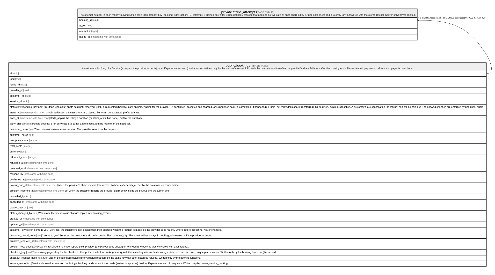

# private.stripe_attempts

## Description

The attempt number in each money-moving Stripe call's idempotency key (booking:<id>:<action>:...:<attempt>). Raised only after Stripe definitely refused that attempt, so two calls at once share a key (Stripe acts once) and a later try isn't answered with the stored refusal. Server only; never deleted.

## Columns

| Name       | Type                     | Default | Nullable | Children | Parents                               | Comment |
| ---------- | ------------------------ | ------- | -------- | -------- | ------------------------------------- | ------- |
| booking_id | uuid                     |         | false    |          | [public.bookings](public.bookings.md) |         |
| action     | text                     |         | false    |          |                                       |         |
| attempt    | integer                  | 1       | false    |          |                                       |         |
| raised_at  | timestamp with time zone |         | true     |          |                                       |         |

## Constraints

| Name                            | Type        | Definition                                                                                          |
| ------------------------------- | ----------- | --------------------------------------------------------------------------------------------------- |
| stripe_attempts_action_check    | CHECK       | CHECK ((action = ANY (ARRAY['transfer'::text, 'refund'::text, 'reversal'::text, 'capture'::text]))) |
| stripe_attempts_attempt_check   | CHECK       | CHECK ((attempt >= 1))                                                                              |
| stripe_attempts_booking_id_fkey | FOREIGN KEY | FOREIGN KEY (booking_id) REFERENCES bookings(id) ON DELETE RESTRICT                                 |
| stripe_attempts_pkey            | PRIMARY KEY | PRIMARY KEY (booking_id, action)                                                                    |

## Indexes

| Name                 | Definition                                                                                           |
| -------------------- | ---------------------------------------------------------------------------------------------------- |
| stripe_attempts_pkey | CREATE UNIQUE INDEX stripe_attempts_pkey ON private.stripe_attempts USING btree (booking_id, action) |

## Triggers

| Name                          | Definition                                                                                                                          |
| ----------------------------- | ----------------------------------------------------------------------------------------------------------------------------------- |
| stripe_attempts_refuse_delete | CREATE TRIGGER stripe_attempts_refuse_delete BEFORE DELETE ON private.stripe_attempts FOR EACH ROW EXECUTE FUNCTION refuse_delete() |

## Relations

---

> Generated by [tbls](https://github.com/k1LoW/tbls)
