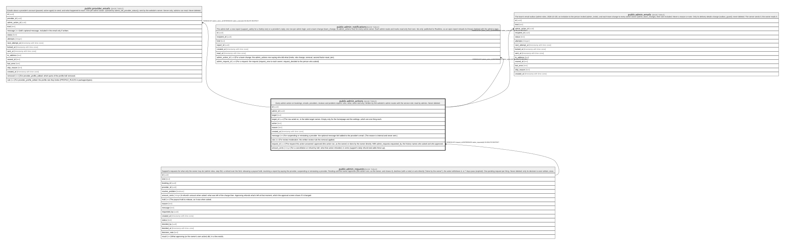

# public.admin_actions

## Description

Every admin action on bookings, emails, providers, reviews and problem reports: who, what, when and why. Written by the website's admin routes with the service role; read by admins. Never deleted.

## Columns

| Name         | Type                     | Default           | Nullable | Children                                                                                                                                                      | Parents                                           | Comment                                                                                                                                                                                  |
| ------------ | ------------------------ | ----------------- | -------- | ------------------------------------------------------------------------------------------------------------------------------------------------------------- | ------------------------------------------------- | ---------------------------------------------------------------------------------------------------------------------------------------------------------------------------------------- |
| id           | uuid                     | gen_random_uuid() | false    | [public.provider_emails](public.provider_emails.md) [public.admin_notifications](public.admin_notifications.md) [public.admin_emails](public.admin_emails.md) |                                                   |                                                                                                                                                                                          |
| admin_id     | uuid                     |                   | true     |                                                                                                                                                               |                                                   |                                                                                                                                                                                          |
| target       | text                     |                   | false    |                                                                                                                                                               |                                                   |                                                                                                                                                                                          |
| target_id    | uuid                     |                   | true     |                                                                                                                                                               |                                                   | The row acted on, in the table target names. Empty only for the homepage and the settings, which are one thing each.                                                                     |
| action       | text                     |                   | false    |                                                                                                                                                               |                                                   |                                                                                                                                                                                          |
| reason       | text                     |                   | true     |                                                                                                                                                               |                                                   |                                                                                                                                                                                          |
| created_at   | timestamp with time zone | clock_timestamp() | false    |                                                                                                                                                               |                                                   |                                                                                                                                                                                          |
| message      | text                     |                   | true     |                                                                                                                                                               |                                                   | For suspending or reinstating a provider: the optional message lokl added to the provider's email. (The reason is internal and never sent.)                                              |
| rule         | text                     |                   | true     |                                                                                                                                                               |                                                   | For review moderation: the written review rule the removal applied.                                                                                                                      |
| request_id   | uuid                     |                   | true     |                                                                                                                                                               | [public.admin_requests](public.admin_requests.md) | The request this action answered: approved (the action ran, as the owner) or done by the owner directly. With admin_requests.requested_by, the history names who asked and who approved. |
| amount_cents | integer                  |                   | true     |                                                                                                                                                               |                                                   | For a cancellation or refund by lokl: what that action refunded, in cents (support's daily refund total adds these up).                                                                  |

## Constraints

| Name                             | Type        | Definition                                                                                                                                                                                                                                                                                                                                                                                                                                                                                                                                                                                                                                                                                                                                                                                                                                                                                                                                                                                                                                                                                              |
| -------------------------------- | ----------- | ------------------------------------------------------------------------------------------------------------------------------------------------------------------------------------------------------------------------------------------------------------------------------------------------------------------------------------------------------------------------------------------------------------------------------------------------------------------------------------------------------------------------------------------------------------------------------------------------------------------------------------------------------------------------------------------------------------------------------------------------------------------------------------------------------------------------------------------------------------------------------------------------------------------------------------------------------------------------------------------------------------------------------------------------------------------------------------------------------- |
| admin_actions_action_check       | CHECK       | CHECK ((action = ANY (ARRAY['cancel_booking'::text, 'release_payout'::text, 'resolve_problem_paid'::text, 'resolve_problem_refunded'::text, 'retry_email'::text, 'suspend_provider'::text, 'reinstate_provider'::text, 'remove_profile_content'::text, 'remove_review'::text, 'restore_review'::text, 'remove_review_reply'::text, 'restore_review_reply'::text, 'dismiss_review_reports'::text, 'support_reply'::text, 'support_reply_wait'::text, 'support_move'::text, 'support_note'::text, 'invite_admin'::text, 'change_admin_role'::text, 'remove_admin'::text, 'reset_admin_mfa'::text, 'join_admin'::text, 'break_glass_owner'::text, 'request_action'::text, 'decline_request'::text, 'withdraw_request'::text, 'limit_reached'::text, 'approve_listing'::text, 'reject_listing'::text, 'unpublish_listing'::text, 'restore_listing'::text, 'publish_guide'::text, 'unpublish_guide'::text, 'set_homepage_features'::text, 'change_admin_settings'::text, 'add_category'::text, 'change_category'::text, 'add_market'::text, 'change_market'::text, 'add_area'::text, 'change_area'::text]))) |
| admin_actions_amount_cents_check | CHECK       | CHECK ((amount_cents >= 0))                                                                                                                                                                                                                                                                                                                                                                                                                                                                                                                                                                                                                                                                                                                                                                                                                                                                                                                                                                                                                                                                             |
| admin_actions_message_check      | CHECK       | CHECK ((char_length(message) <= 1000))                                                                                                                                                                                                                                                                                                                                                                                                                                                                                                                                                                                                                                                                                                                                                                                                                                                                                                                                                                                                                                                                  |
| admin_actions_reason             | CHECK       | CHECK (((action = ANY (ARRAY['retry_email'::text, 'support_reply'::text, 'support_reply_wait'::text, 'support_move'::text, 'support_note'::text, 'join_admin'::text, 'withdraw_request'::text, 'limit_reached'::text, 'approve_listing'::text, 'restore_listing'::text, 'publish_guide'::text, 'unpublish_guide'::text, 'set_homepage_features'::text, 'add_category'::text, 'change_category'::text, 'add_market'::text, 'change_market'::text, 'add_area'::text, 'change_area'::text])) OR (char_length(TRIM(BOTH FROM reason)) >= 5)))                                                                                                                                                                                                                                                                                                                                                                                                                                                                                                                                                               |
| admin_actions_reason_check       | CHECK       | CHECK ((char_length(reason) <= 1000))                                                                                                                                                                                                                                                                                                                                                                                                                                                                                                                                                                                                                                                                                                                                                                                                                                                                                                                                                                                                                                                                   |
| admin_actions_rule_check         | CHECK       | CHECK ((char_length(rule) <= 60))                                                                                                                                                                                                                                                                                                                                                                                                                                                                                                                                                                                                                                                                                                                                                                                                                                                                                                                                                                                                                                                                       |
| admin_actions_target_check       | CHECK       | CHECK ((target = ANY (ARRAY['booking'::text, 'provider'::text, 'email'::text, 'review'::text, 'support_report'::text, 'admin_member'::text, 'admin_request'::text, 'listing'::text, 'guide'::text, 'homepage'::text, 'settings'::text, 'category'::text, 'market'::text, 'area'::text])))                                                                                                                                                                                                                                                                                                                                                                                                                                                                                                                                                                                                                                                                                                                                                                                                               |
| admin_actions_target_id          | CHECK       | CHECK (((target = ANY (ARRAY['homepage'::text, 'settings'::text])) = (target_id IS NULL)))                                                                                                                                                                                                                                                                                                                                                                                                                                                                                                                                                                                                                                                                                                                                                                                                                                                                                                                                                                                                              |
| admin_actions_admin_id_fkey      | FOREIGN KEY | FOREIGN KEY (admin_id) REFERENCES auth.users(id) ON DELETE SET NULL                                                                                                                                                                                                                                                                                                                                                                                                                                                                                                                                                                                                                                                                                                                                                                                                                                                                                                                                                                                                                                     |
| admin_actions_pkey               | PRIMARY KEY | PRIMARY KEY (id)                                                                                                                                                                                                                                                                                                                                                                                                                                                                                                                                                                                                                                                                                                                                                                                                                                                                                                                                                                                                                                                                                        |
| admin_actions_request_id_fkey    | FOREIGN KEY | FOREIGN KEY (request_id) REFERENCES admin_requests(id) ON DELETE RESTRICT                                                                                                                                                                                                                                                                                                                                                                                                                                                                                                                                                                                                                                                                                                                                                                                                                                                                                                                                                                                                                               |

## Indexes

| Name                     | Definition                                                                                                         |
| ------------------------ | ------------------------------------------------------------------------------------------------------------------ |
| admin_actions_pkey       | CREATE UNIQUE INDEX admin_actions_pkey ON public.admin_actions USING btree (id)                                    |
| admin_actions_target_idx | CREATE INDEX admin_actions_target_idx ON public.admin_actions USING btree (target, target_id, created_at)          |
| admin_actions_request    | CREATE INDEX admin_actions_request ON public.admin_actions USING btree (request_id) WHERE (request_id IS NOT NULL) |

## Triggers

| Name                               | Definition                                                                                                                                           |
| ---------------------------------- | ---------------------------------------------------------------------------------------------------------------------------------------------------- |
| admin_actions_append_only          | CREATE TRIGGER admin_actions_append_only BEFORE DELETE OR UPDATE ON public.admin_actions FOR EACH ROW EXECUTE FUNCTION append_only_guard('admin_id') |
| admin_actions_append_only_truncate | CREATE TRIGGER admin_actions_append_only_truncate BEFORE TRUNCATE ON public.admin_actions FOR EACH STATEMENT EXECUTE FUNCTION append_only_guard()    |

## Relations

---

> Generated by [tbls](https://github.com/k1LoW/tbls)
