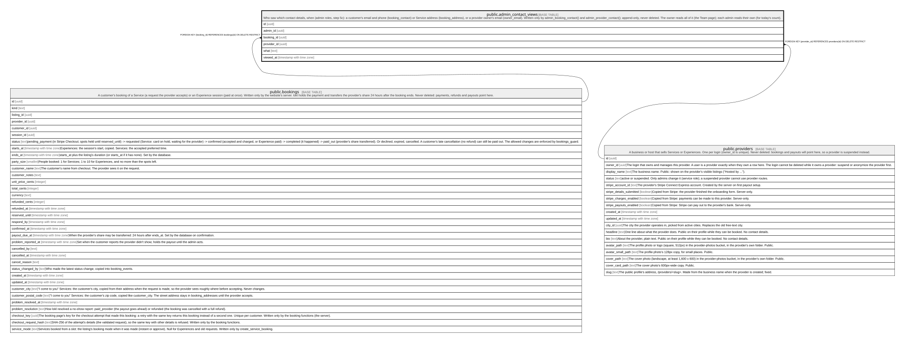

# public.admin_contact_views

## Description

Who saw which contact details, when (admin roles, step 5c): a customer's email and phone (booking_contact) or Service address (booking_address), or a provider owner's email (owner_email). Written only by admin_booking_contact() and admin_provider_contact(); append-only, never deleted. The owner reads all of it (the Team page); each admin reads their own (for today's count).

## Columns

| Name        | Type                     | Default           | Nullable | Children | Parents                                 | Comment |
| ----------- | ------------------------ | ----------------- | -------- | -------- | --------------------------------------- | ------- |
| id          | uuid                     | gen_random_uuid() | false    |          |                                         |         |
| admin_id    | uuid                     |                   | false    |          |                                         |         |
| booking_id  | uuid                     |                   | true     |          | [public.bookings](public.bookings.md)   |         |
| provider_id | uuid                     |                   | true     |          | [public.providers](public.providers.md) |         |
| what        | text                     |                   | false    |          |                                         |         |
| viewed_at   | timestamp with time zone | clock_timestamp() | false    |          |                                         |         |

## Constraints

| Name                                 | Type        | Definition                                                                                                                              |
| ------------------------------------ | ----------- | --------------------------------------------------------------------------------------------------------------------------------------- |
| admin_contact_views_check            | CHECK       | CHECK (((what = 'owner_email'::text) = ((provider_id IS NOT NULL) AND (booking_id IS NULL))))                                           |
| admin_contact_views_check1           | CHECK       | CHECK (((what = ANY (ARRAY['booking_contact'::text, 'booking_address'::text])) = ((booking_id IS NOT NULL) AND (provider_id IS NULL)))) |
| admin_contact_views_what_check       | CHECK       | CHECK ((what = ANY (ARRAY['booking_contact'::text, 'booking_address'::text, 'owner_email'::text])))                                     |
| admin_contact_views_admin_id_fkey    | FOREIGN KEY | FOREIGN KEY (admin_id) REFERENCES auth.users(id) ON DELETE RESTRICT                                                                     |
| admin_contact_views_provider_id_fkey | FOREIGN KEY | FOREIGN KEY (provider_id) REFERENCES providers(id) ON DELETE RESTRICT                                                                   |
| admin_contact_views_booking_id_fkey  | FOREIGN KEY | FOREIGN KEY (booking_id) REFERENCES bookings(id) ON DELETE RESTRICT                                                                     |
| admin_contact_views_pkey             | PRIMARY KEY | PRIMARY KEY (id)                                                                                                                        |

## Indexes

| Name                          | Definition                                                                                                                        |
| ----------------------------- | --------------------------------------------------------------------------------------------------------------------------------- |
| admin_contact_views_pkey      | CREATE UNIQUE INDEX admin_contact_views_pkey ON public.admin_contact_views USING btree (id)                                       |
| admin_contact_views_admin_day | CREATE INDEX admin_contact_views_admin_day ON public.admin_contact_views USING btree (admin_id, viewed_at DESC)                   |
| admin_contact_views_viewed    | CREATE INDEX admin_contact_views_viewed ON public.admin_contact_views USING btree (viewed_at DESC)                                |
| admin_contact_views_booking   | CREATE INDEX admin_contact_views_booking ON public.admin_contact_views USING btree (booking_id) WHERE (booking_id IS NOT NULL)    |
| admin_contact_views_provider  | CREATE INDEX admin_contact_views_provider ON public.admin_contact_views USING btree (provider_id) WHERE (provider_id IS NOT NULL) |

## Triggers

| Name                                     | Definition                                                                                                                                                    |
| ---------------------------------------- | ------------------------------------------------------------------------------------------------------------------------------------------------------------- |
| admin_contact_views_append_only          | CREATE TRIGGER admin_contact_views_append_only BEFORE DELETE OR UPDATE ON public.admin_contact_views FOR EACH ROW EXECUTE FUNCTION append_only_guard()        |
| admin_contact_views_append_only_truncate | CREATE TRIGGER admin_contact_views_append_only_truncate BEFORE TRUNCATE ON public.admin_contact_views FOR EACH STATEMENT EXECUTE FUNCTION append_only_guard() |

## Relations

---

> Generated by [tbls](https://github.com/k1LoW/tbls)
