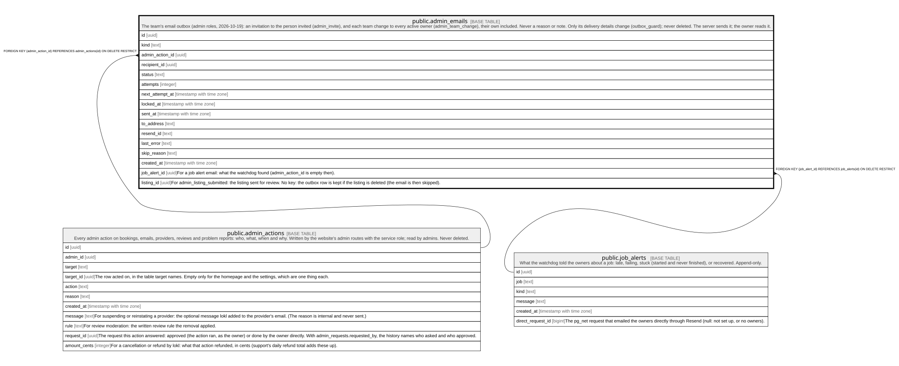

# public.admin_emails

## Description

The team's email outbox (admin roles, 2026-10-19): an invitation to the person invited (admin_invite), and each team change to every active owner (admin_team_change), their own included. Never a reason or note. Only its delivery details change (outbox_guard); never deleted. The server sends it; the owner reads it.

## Columns

| Name            | Type                     | Default           | Nullable | Children | Parents                                         | Comment |
| --------------- | ------------------------ | ----------------- | -------- | -------- | ----------------------------------------------- | ------- |
| id              | uuid                     | gen_random_uuid() | false    |          |                                                 |         |
| kind            | text                     |                   | false    |          |                                                 |         |
| admin_action_id | uuid                     |                   | false    |          | [public.admin_actions](public.admin_actions.md) |         |
| recipient_id    | uuid                     |                   | false    |          |                                                 |         |
| status          | text                     | 'pending'::text   | false    |          |                                                 |         |
| attempts        | integer                  | 0                 | false    |          |                                                 |         |
| next_attempt_at | timestamp with time zone | now()             | false    |          |                                                 |         |
| locked_at       | timestamp with time zone |                   | true     |          |                                                 |         |
| sent_at         | timestamp with time zone |                   | true     |          |                                                 |         |
| to_address      | text                     |                   | true     |          |                                                 |         |
| resend_id       | text                     |                   | true     |          |                                                 |         |
| last_error      | text                     |                   | true     |          |                                                 |         |
| skip_reason     | text                     |                   | true     |          |                                                 |         |
| created_at      | timestamp with time zone | clock_timestamp() | false    |          |                                                 |         |

## Constraints

| Name                              | Type        | Definition                                                                                                      |
| --------------------------------- | ----------- | --------------------------------------------------------------------------------------------------------------- |
| admin_emails_attempts_check       | CHECK       | CHECK ((attempts >= 0))                                                                                         |
| admin_emails_kind_check           | CHECK       | CHECK ((kind = ANY (ARRAY['admin_invite'::text, 'admin_team_change'::text])))                                   |
| admin_emails_last_error_check     | CHECK       | CHECK ((char_length(last_error) <= 500))                                                                        |
| admin_emails_skip_reason_check    | CHECK       | CHECK ((char_length(skip_reason) <= 200))                                                                       |
| admin_emails_status_check         | CHECK       | CHECK ((status = ANY (ARRAY['pending'::text, 'sending'::text, 'sent'::text, 'skipped'::text, 'failed'::text]))) |
| admin_emails_to_address_check     | CHECK       | CHECK ((char_length(to_address) <= 320))                                                                        |
| admin_emails_admin_action_id_fkey | FOREIGN KEY | FOREIGN KEY (admin_action_id) REFERENCES admin_actions(id) ON DELETE RESTRICT                                   |
| admin_emails_pkey                 | PRIMARY KEY | PRIMARY KEY (id)                                                                                                |

## Indexes

| Name              | Definition                                                                                                                                       |
| ----------------- | ------------------------------------------------------------------------------------------------------------------------------------------------ |
| admin_emails_pkey | CREATE UNIQUE INDEX admin_emails_pkey ON public.admin_emails USING btree (id)                                                                    |
| admin_emails_due  | CREATE INDEX admin_emails_due ON public.admin_emails USING btree (next_attempt_at) WHERE (status = ANY (ARRAY['pending'::text, 'failed'::text])) |

## Triggers

| Name                               | Definition                                                                                                                                  |
| ---------------------------------- | ------------------------------------------------------------------------------------------------------------------------------------------- |
| admin_emails_outbox_guard          | CREATE TRIGGER admin_emails_outbox_guard BEFORE DELETE OR UPDATE ON public.admin_emails FOR EACH ROW EXECUTE FUNCTION outbox_guard()        |
| admin_emails_outbox_guard_truncate | CREATE TRIGGER admin_emails_outbox_guard_truncate BEFORE TRUNCATE ON public.admin_emails FOR EACH STATEMENT EXECUTE FUNCTION outbox_guard() |

## Relations

---

> Generated by [tbls](https://github.com/k1LoW/tbls)
