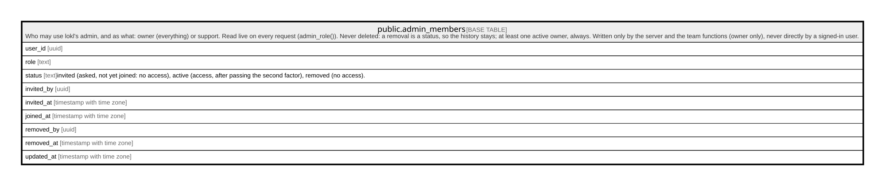

# public.admin_members

## Description

Who may use lokl's admin, and as what: owner (everything) or support. Read live on every request (admin_role()). Never deleted: a removal is a status, so the history stays; at least one active owner, always. Written only by the server and the team functions (owner only), never directly by a signed-in user.

## Columns

| Name       | Type                     | Default         | Nullable | Children | Parents | Comment                                                                                                            |
| ---------- | ------------------------ | --------------- | -------- | -------- | ------- | ------------------------------------------------------------------------------------------------------------------ |
| user_id    | uuid                     |                 | false    |          |         |                                                                                                                    |
| role       | text                     |                 | false    |          |         |                                                                                                                    |
| status     | text                     | 'invited'::text | false    |          |         | invited (asked, not yet joined: no access), active (access, after passing the second factor), removed (no access). |
| invited_by | uuid                     |                 | true     |          |         |                                                                                                                    |
| invited_at | timestamp with time zone | now()           | false    |          |         |                                                                                                                    |
| joined_at  | timestamp with time zone |                 | true     |          |         |                                                                                                                    |
| removed_by | uuid                     |                 | true     |          |         |                                                                                                                    |
| removed_at | timestamp with time zone |                 | true     |          |         |                                                                                                                    |
| updated_at | timestamp with time zone | now()           | false    |          |         |                                                                                                                    |

## Constraints

| Name                          | Type        | Definition                                                                       |
| ----------------------------- | ----------- | -------------------------------------------------------------------------------- |
| admin_members_check           | CHECK       | CHECK (((status <> 'active'::text) OR (joined_at IS NOT NULL)))                  |
| admin_members_check1          | CHECK       | CHECK (((status <> 'removed'::text) OR (removed_at IS NOT NULL)))                |
| admin_members_role_check      | CHECK       | CHECK ((role = ANY (ARRAY['owner'::text, 'support'::text])))                     |
| admin_members_status_check    | CHECK       | CHECK ((status = ANY (ARRAY['invited'::text, 'active'::text, 'removed'::text]))) |
| admin_members_invited_by_fkey | FOREIGN KEY | FOREIGN KEY (invited_by) REFERENCES auth.users(id) ON DELETE SET NULL            |
| admin_members_removed_by_fkey | FOREIGN KEY | FOREIGN KEY (removed_by) REFERENCES auth.users(id) ON DELETE SET NULL            |
| admin_members_user_id_fkey    | FOREIGN KEY | FOREIGN KEY (user_id) REFERENCES auth.users(id) ON DELETE RESTRICT               |
| admin_members_pkey            | PRIMARY KEY | PRIMARY KEY (user_id)                                                            |

## Indexes

| Name               | Definition                                                                           |
| ------------------ | ------------------------------------------------------------------------------------ |
| admin_members_pkey | CREATE UNIQUE INDEX admin_members_pkey ON public.admin_members USING btree (user_id) |

## Triggers

| Name                           | Definition                                                                                                                                                                      |
| ------------------------------ | ------------------------------------------------------------------------------------------------------------------------------------------------------------------------------- |
| admin_members_keep_an_owner    | CREATE TRIGGER admin_members_keep_an_owner BEFORE UPDATE ON public.admin_members FOR EACH ROW EXECUTE FUNCTION admin_members_keep_an_owner()                                    |
| admin_members_never_delete     | CREATE TRIGGER admin_members_never_delete BEFORE DELETE ON public.admin_members FOR EACH ROW EXECUTE FUNCTION admin_members_never_delete()                                      |
| admin_members_never_truncate   | CREATE TRIGGER admin_members_never_truncate BEFORE TRUNCATE ON public.admin_members FOR EACH STATEMENT EXECUTE FUNCTION admin_members_never_delete()                            |
| admin_members_owns_no_provider | CREATE TRIGGER admin_members_owns_no_provider BEFORE INSERT OR UPDATE OF user_id, status ON public.admin_members FOR EACH ROW EXECUTE FUNCTION admin_members_owns_no_provider() |
| admin_members_set_updated_at   | CREATE TRIGGER admin_members_set_updated_at BEFORE UPDATE ON public.admin_members FOR EACH ROW EXECUTE FUNCTION set_updated_at()                                                |

## Relations

---

> Generated by [tbls](https://github.com/k1LoW/tbls)
