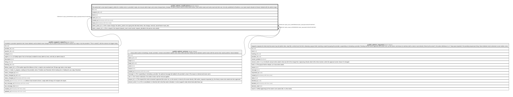

# public.admin_notifications

## Description

The admin bell: a new report (support_safety for a Safety one) or a provider's reply, one row per admin login; and a team change (team_change, its admin_actions row) for every active owner. Each admin reads and marks read only their own. Ids only: published to Realtime, so an open report reloads its thread. Deleted with the admin's login.

## Columns

| Name             | Type                     | Default           | Nullable | Children | Parents                                             | Comment                                                                                                                 |
| ---------------- | ------------------------ | ----------------- | -------- | -------- | --------------------------------------------------- | ----------------------------------------------------------------------------------------------------------------------- |
| id               | uuid                     | gen_random_uuid() | false    |          |                                                     |                                                                                                                         |
| recipient_id     | uuid                     |                   | false    |          |                                                     |                                                                                                                         |
| kind             | text                     |                   | false    |          |                                                     |                                                                                                                         |
| report_id        | uuid                     |                   | true     |          | [public.support_reports](public.support_reports.md) |                                                                                                                         |
| created_at       | timestamp with time zone | now()             | false    |          |                                                     |                                                                                                                         |
| read_at          | timestamp with time zone |                   | true     |          |                                                     |                                                                                                                         |
| admin_action_id  | uuid                     |                   | true     |          | [public.admin_actions](public.admin_actions.md)     | For a team change: the admin_actions row saying who did what (invite, role change, removal, second factor reset, join). |
| admin_request_id | uuid                     |                   | true     |          | [public.admin_requests](public.admin_requests.md)   | For a request: the request (request_new to each owner; request_decided to the person who asked).                        |

## Constraints

| Name                                      | Type        | Definition                                                                                                                                                                                                                                                                                                                                                                                                                                                                                                                |
| ----------------------------------------- | ----------- | ------------------------------------------------------------------------------------------------------------------------------------------------------------------------------------------------------------------------------------------------------------------------------------------------------------------------------------------------------------------------------------------------------------------------------------------------------------------------------------------------------------------------- |
| admin_notifications_about_check           | CHECK       | CHECK (((num_nonnulls(report_id, admin_action_id, admin_request_id) = 1) AND ((kind = ANY (ARRAY['support_new'::text, 'support_safety'::text, 'support_reply'::text])) = (report_id IS NOT NULL)) AND ((kind = ANY (ARRAY['team_change'::text, 'limit_reached'::text, 'support_refund'::text, 'listing_taken_down'::text, 'settings_change'::text, 'profile_hidden'::text])) = (admin_action_id IS NOT NULL)) AND ((kind = ANY (ARRAY['request_new'::text, 'request_decided'::text])) = (admin_request_id IS NOT NULL)))) |
| admin_notifications_kind_check            | CHECK       | CHECK ((kind = ANY (ARRAY['support_new'::text, 'support_safety'::text, 'support_reply'::text, 'team_change'::text, 'request_new'::text, 'request_decided'::text, 'limit_reached'::text, 'support_refund'::text, 'listing_taken_down'::text, 'settings_change'::text, 'profile_hidden'::text])))                                                                                                                                                                                                                           |
| admin_notifications_recipient_id_fkey     | FOREIGN KEY | FOREIGN KEY (recipient_id) REFERENCES auth.users(id) ON DELETE CASCADE                                                                                                                                                                                                                                                                                                                                                                                                                                                    |
| admin_notifications_admin_action_id_fkey  | FOREIGN KEY | FOREIGN KEY (admin_action_id) REFERENCES admin_actions(id) ON DELETE RESTRICT                                                                                                                                                                                                                                                                                                                                                                                                                                             |
| admin_notifications_report_id_fkey        | FOREIGN KEY | FOREIGN KEY (report_id) REFERENCES support_reports(id) ON DELETE RESTRICT                                                                                                                                                                                                                                                                                                                                                                                                                                                 |
| admin_notifications_pkey                  | PRIMARY KEY | PRIMARY KEY (id)                                                                                                                                                                                                                                                                                                                                                                                                                                                                                                          |
| admin_notifications_admin_request_id_fkey | FOREIGN KEY | FOREIGN KEY (admin_request_id) REFERENCES admin_requests(id) ON DELETE RESTRICT                                                                                                                                                                                                                                                                                                                                                                                                                                           |

## Indexes

| Name                              | Definition                                                                                                                                       |
| --------------------------------- | ------------------------------------------------------------------------------------------------------------------------------------------------ |
| admin_notifications_pkey          | CREATE UNIQUE INDEX admin_notifications_pkey ON public.admin_notifications USING btree (id)                                                      |
| admin_notifications_recipient     | CREATE INDEX admin_notifications_recipient ON public.admin_notifications USING btree (recipient_id, created_at DESC)                             |
| admin_notifications_unread        | CREATE INDEX admin_notifications_unread ON public.admin_notifications USING btree (recipient_id) WHERE (read_at IS NULL)                         |
| admin_notifications_report        | CREATE INDEX admin_notifications_report ON public.admin_notifications USING btree (report_id)                                                    |
| admin_notifications_admin_action  | CREATE INDEX admin_notifications_admin_action ON public.admin_notifications USING btree (admin_action_id) WHERE (admin_action_id IS NOT NULL)    |
| admin_notifications_admin_request | CREATE INDEX admin_notifications_admin_request ON public.admin_notifications USING btree (admin_request_id) WHERE (admin_request_id IS NOT NULL) |

## Triggers

| Name                            | Definition                                                                                                                                                      |
| ------------------------------- | --------------------------------------------------------------------------------------------------------------------------------------------------------------- |
| admin_notifications_set_read_at | CREATE TRIGGER admin_notifications_set_read_at BEFORE UPDATE OF read_at ON public.admin_notifications FOR EACH ROW EXECUTE FUNCTION notifications_set_read_at() |

## Relations

---

> Generated by [tbls](https://github.com/k1LoW/tbls)
