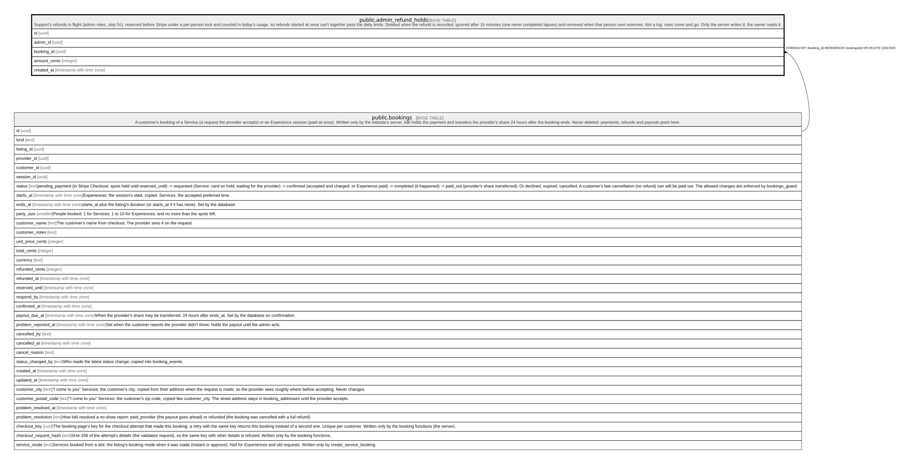

# public.admin_refund_holds

## Description

Support's refunds in flight (admin roles, step 5c): reserved before Stripe under a per-person lock and counted in today's usage, so refunds started at once can't together pass the daily limits. Deleted when the refund is recorded; ignored after 15 minutes (one never completed lapses) and removed when that person next reserves. Not a log: rows come and go. Only the server writes it; the owner reads it.

## Columns

| Name         | Type                     | Default           | Nullable | Children | Parents                               | Comment |
| ------------ | ------------------------ | ----------------- | -------- | -------- | ------------------------------------- | ------- |
| id           | uuid                     | gen_random_uuid() | false    |          |                                       |         |
| admin_id     | uuid                     |                   | false    |          |                                       |         |
| booking_id   | uuid                     |                   | false    |          | [public.bookings](public.bookings.md) |         |
| amount_cents | integer                  |                   | false    |          |                                       |         |
| created_at   | timestamp with time zone | clock_timestamp() | false    |          |                                       |         |

## Constraints

| Name                                       | Type        | Definition                                                         |
| ------------------------------------------ | ----------- | ------------------------------------------------------------------ |
| admin_refund_holds_amount_cents_check      | CHECK       | CHECK ((amount_cents >= 0))                                        |
| admin_refund_holds_admin_id_fkey           | FOREIGN KEY | FOREIGN KEY (admin_id) REFERENCES auth.users(id) ON DELETE CASCADE |
| admin_refund_holds_booking_id_fkey         | FOREIGN KEY | FOREIGN KEY (booking_id) REFERENCES bookings(id) ON DELETE CASCADE |
| admin_refund_holds_pkey                    | PRIMARY KEY | PRIMARY KEY (id)                                                   |
| admin_refund_holds_admin_id_booking_id_key | UNIQUE      | UNIQUE (admin_id, booking_id)                                      |

## Indexes

| Name                                       | Definition                                                                                                                     |
| ------------------------------------------ | ------------------------------------------------------------------------------------------------------------------------------ |
| admin_refund_holds_pkey                    | CREATE UNIQUE INDEX admin_refund_holds_pkey ON public.admin_refund_holds USING btree (id)                                      |
| admin_refund_holds_admin_id_booking_id_key | CREATE UNIQUE INDEX admin_refund_holds_admin_id_booking_id_key ON public.admin_refund_holds USING btree (admin_id, booking_id) |
| admin_refund_holds_admin                   | CREATE INDEX admin_refund_holds_admin ON public.admin_refund_holds USING btree (admin_id, created_at)                          |

## Relations

---

> Generated by [tbls](https://github.com/k1LoW/tbls)
