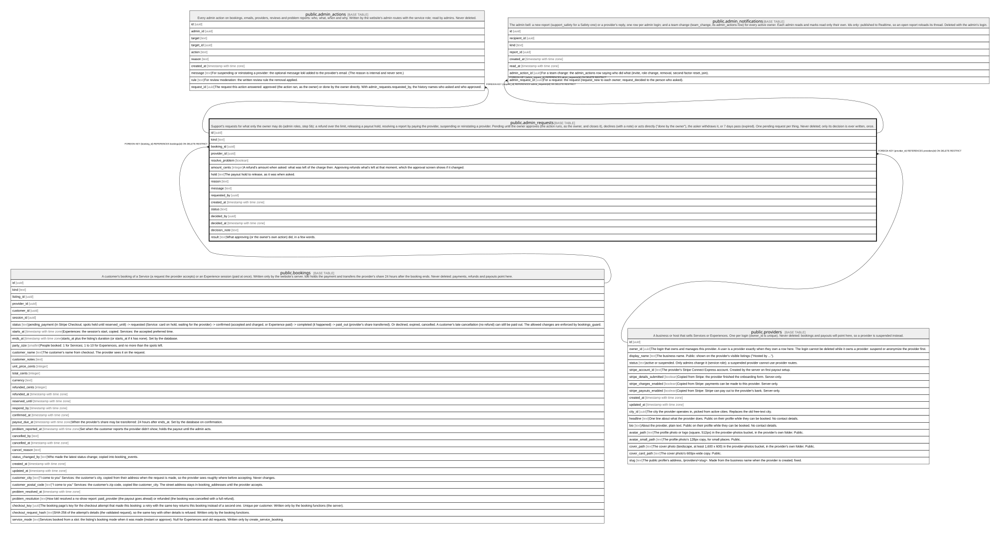

# public.admin_requests

## Description

Support's requests for what only the owner may do (admin roles, step 5b): a refund over the limit, releasing a payout hold, resolving a report by paying the provider, suspending or reinstating a provider. Pending until the owner approves (the action runs, as the owner, and closes it), declines (with a note) or acts directly ("done by the owner"), the asker withdraws it, or 7 days pass (expired). One pending request per thing. Never deleted; only its decision is ever written, once.

## Columns

| Name            | Type                     | Default           | Nullable | Children                                                                                                    | Parents                                 | Comment                                                                                                                                                      |
| --------------- | ------------------------ | ----------------- | -------- | ----------------------------------------------------------------------------------------------------------- | --------------------------------------- | ------------------------------------------------------------------------------------------------------------------------------------------------------------ |
| id              | uuid                     | gen_random_uuid() | false    | [public.admin_actions](public.admin_actions.md) [public.admin_notifications](public.admin_notifications.md) |                                         |                                                                                                                                                              |
| kind            | text                     |                   | false    |                                                                                                             |                                         |                                                                                                                                                              |
| booking_id      | uuid                     |                   | true     |                                                                                                             | [public.bookings](public.bookings.md)   |                                                                                                                                                              |
| provider_id     | uuid                     |                   | true     |                                                                                                             | [public.providers](public.providers.md) |                                                                                                                                                              |
| resolve_problem | boolean                  | false             | false    |                                                                                                             |                                         |                                                                                                                                                              |
| amount_cents    | integer                  |                   | true     |                                                                                                             |                                         | A refund's amount when asked: what was left of the charge then. Approving refunds what's left at that moment, which the approval screen shows if it changed. |
| hold            | text                     |                   | true     |                                                                                                             |                                         | The payout hold to release, as it was when asked.                                                                                                            |
| reason          | text                     |                   | false    |                                                                                                             |                                         |                                                                                                                                                              |
| message         | text                     |                   | true     |                                                                                                             |                                         |                                                                                                                                                              |
| requested_by    | uuid                     |                   | false    |                                                                                                             |                                         |                                                                                                                                                              |
| created_at      | timestamp with time zone | now()             | false    |                                                                                                             |                                         |                                                                                                                                                              |
| status          | text                     | 'pending'::text   | false    |                                                                                                             |                                         |                                                                                                                                                              |
| decided_by      | uuid                     |                   | true     |                                                                                                             |                                         |                                                                                                                                                              |
| decided_at      | timestamp with time zone |                   | true     |                                                                                                             |                                         |                                                                                                                                                              |
| decision_note   | text                     |                   | true     |                                                                                                             |                                         |                                                                                                                                                              |
| result          | text                     |                   | true     |                                                                                                             |                                         | What approving (or the owner's own action) did, in a few words.                                                                                              |

## Constraints

| Name                               | Type        | Definition                                                                                                                                                  |
| ---------------------------------- | ----------- | ----------------------------------------------------------------------------------------------------------------------------------------------------------- |
| admin_requests_amount_cents_check  | CHECK       | CHECK ((amount_cents >= 0))                                                                                                                                 |
| admin_requests_check               | CHECK       | CHECK (((kind = ANY (ARRAY['suspend_provider'::text, 'reinstate_provider'::text])) = ((provider_id IS NOT NULL) AND (booking_id IS NULL))))                 |
| admin_requests_check1              | CHECK       | CHECK (((kind = ANY (ARRAY['refund'::text, 'release_payout'::text, 'resolve_problem_paid'::text])) = ((booking_id IS NOT NULL) AND (provider_id IS NULL)))) |
| admin_requests_check2              | CHECK       | CHECK (((resolve_problem = false) OR (kind = 'refund'::text)))                                                                                              |
| admin_requests_check3              | CHECK       | CHECK (((kind = 'refund'::text) = (amount_cents IS NOT NULL)))                                                                                              |
| admin_requests_check4              | CHECK       | CHECK (((kind = 'release_payout'::text) = (hold IS NOT NULL)))                                                                                              |
| admin_requests_check5              | CHECK       | CHECK (((message IS NULL) OR (kind = ANY (ARRAY['suspend_provider'::text, 'reinstate_provider'::text]))))                                                   |
| admin_requests_check6              | CHECK       | CHECK (((status = 'pending'::text) = (decided_at IS NULL)))                                                                                                 |
| admin_requests_decision_note_check | CHECK       | CHECK ((char_length(decision_note) <= 1000))                                                                                                                |
| admin_requests_kind_check          | CHECK       | CHECK ((kind = ANY (ARRAY['refund'::text, 'release_payout'::text, 'resolve_problem_paid'::text, 'suspend_provider'::text, 'reinstate_provider'::text])))    |
| admin_requests_message_check       | CHECK       | CHECK ((char_length(message) <= 1000))                                                                                                                      |
| admin_requests_reason_check        | CHECK       | CHECK (((char_length(TRIM(BOTH FROM reason)) >= 5) AND (char_length(TRIM(BOTH FROM reason)) <= 1000)))                                                      |
| admin_requests_result_check        | CHECK       | CHECK ((char_length(result) <= 300))                                                                                                                        |
| admin_requests_status_check        | CHECK       | CHECK ((status = ANY (ARRAY['pending'::text, 'approved'::text, 'declined'::text, 'withdrawn'::text, 'expired'::text, 'done_by_owner'::text])))              |
| admin_requests_decided_by_fkey     | FOREIGN KEY | FOREIGN KEY (decided_by) REFERENCES auth.users(id) ON DELETE RESTRICT                                                                                       |
| admin_requests_requested_by_fkey   | FOREIGN KEY | FOREIGN KEY (requested_by) REFERENCES auth.users(id) ON DELETE RESTRICT                                                                                     |
| admin_requests_provider_id_fkey    | FOREIGN KEY | FOREIGN KEY (provider_id) REFERENCES providers(id) ON DELETE RESTRICT                                                                                       |
| admin_requests_booking_id_fkey     | FOREIGN KEY | FOREIGN KEY (booking_id) REFERENCES bookings(id) ON DELETE RESTRICT                                                                                         |
| admin_requests_pkey                | PRIMARY KEY | PRIMARY KEY (id)                                                                                                                                            |

## Indexes

| Name                        | Definition                                                                                                                                                     |
| --------------------------- | -------------------------------------------------------------------------------------------------------------------------------------------------------------- |
| admin_requests_pkey         | CREATE UNIQUE INDEX admin_requests_pkey ON public.admin_requests USING btree (id)                                                                              |
| admin_requests_one_pending  | CREATE UNIQUE INDEX admin_requests_one_pending ON public.admin_requests USING btree (kind, COALESCE(booking_id, provider_id)) WHERE (status = 'pending'::text) |
| admin_requests_pending      | CREATE INDEX admin_requests_pending ON public.admin_requests USING btree (created_at) WHERE (status = 'pending'::text)                                         |
| admin_requests_requested_by | CREATE INDEX admin_requests_requested_by ON public.admin_requests USING btree (requested_by, created_at DESC)                                                  |
| admin_requests_booking      | CREATE INDEX admin_requests_booking ON public.admin_requests USING btree (booking_id) WHERE (booking_id IS NOT NULL)                                           |
| admin_requests_provider     | CREATE INDEX admin_requests_provider ON public.admin_requests USING btree (provider_id) WHERE (provider_id IS NOT NULL)                                        |

## Triggers

| Name                          | Definition                                                                                                                                       |
| ----------------------------- | ------------------------------------------------------------------------------------------------------------------------------------------------ |
| admin_requests_guard          | CREATE TRIGGER admin_requests_guard BEFORE DELETE OR UPDATE ON public.admin_requests FOR EACH ROW EXECUTE FUNCTION admin_requests_guard()        |
| admin_requests_guard_truncate | CREATE TRIGGER admin_requests_guard_truncate BEFORE TRUNCATE ON public.admin_requests FOR EACH STATEMENT EXECUTE FUNCTION admin_requests_guard() |

## Relations

---

> Generated by [tbls](https://github.com/k1LoW/tbls)
