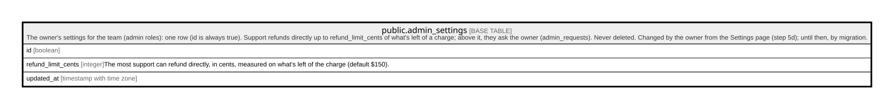

# public.admin_settings

## Description

The owner's settings for the team (admin roles): one row (id is always true). Support refunds directly up to refund_limit_cents of what's left of a charge; above it, they ask the owner (admin_requests). Never deleted. Changed by the owner from the Settings page (step 5d); until then, by migration.

## Columns

| Name               | Type                     | Default | Nullable | Children | Parents | Comment                                                                                               |
| ------------------ | ------------------------ | ------- | -------- | -------- | ------- | ----------------------------------------------------------------------------------------------------- |
| id                 | boolean                  | true    | false    |          |         |                                                                                                       |
| refund_limit_cents | integer                  | 15000   | false    |          |         | The most support can refund directly, in cents, measured on what's left of the charge (default $150). |
| updated_at         | timestamp with time zone | now()   | false    |          |         |                                                                                                       |

## Constraints

| Name                                    | Type        | Definition                                                              |
| --------------------------------------- | ----------- | ----------------------------------------------------------------------- |
| admin_settings_id_check                 | CHECK       | CHECK (id)                                                              |
| admin_settings_refund_limit_cents_check | CHECK       | CHECK (((refund_limit_cents >= 0) AND (refund_limit_cents <= 1000000))) |
| admin_settings_pkey                     | PRIMARY KEY | PRIMARY KEY (id)                                                        |

## Indexes

| Name                | Definition                                                                        |
| ------------------- | --------------------------------------------------------------------------------- |
| admin_settings_pkey | CREATE UNIQUE INDEX admin_settings_pkey ON public.admin_settings USING btree (id) |

## Triggers

| Name                          | Definition                                                                                                                         |
| ----------------------------- | ---------------------------------------------------------------------------------------------------------------------------------- |
| admin_settings_set_updated_at | CREATE TRIGGER admin_settings_set_updated_at BEFORE UPDATE ON public.admin_settings FOR EACH ROW EXECUTE FUNCTION set_updated_at() |

## Relations

---

> Generated by [tbls](https://github.com/k1LoW/tbls)
