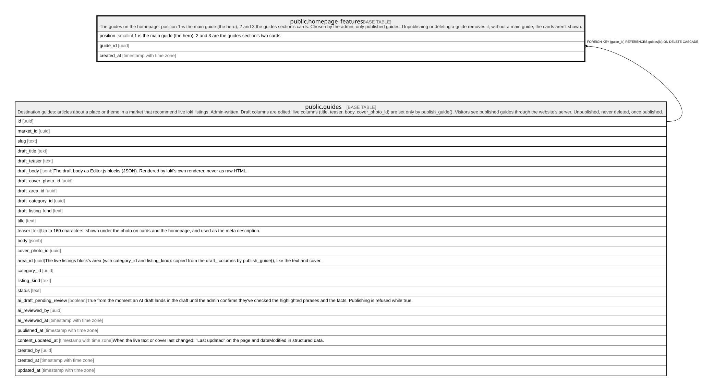

# public.homepage_features

## Description

The guides on the homepage: position 1 is the main guide (the hero), 2 and 3 the guides section's cards. Chosen by the admin; only published guides. Unpublishing or deleting a guide removes it; without a main guide, the cards aren't shown.

## Columns

| Name       | Type                     | Default | Nullable | Children | Parents                           | Comment                                                                     |
| ---------- | ------------------------ | ------- | -------- | -------- | --------------------------------- | --------------------------------------------------------------------------- |
| position   | smallint                 |         | false    |          |                                   | 1 is the main guide (the hero); 2 and 3 are the guides section's two cards. |
| guide_id   | uuid                     |         | false    |          | [public.guides](public.guides.md) |                                                                             |
| created_at | timestamp with time zone | now()   | false    |          |                                   |                                                                             |

## Constraints

| Name                             | Type        | Definition                                                     |
| -------------------------------- | ----------- | -------------------------------------------------------------- |
| homepage_features_position_check | CHECK       | CHECK ((("position" >= 1) AND ("position" <= 3)))              |
| homepage_features_guide_id_fkey  | FOREIGN KEY | FOREIGN KEY (guide_id) REFERENCES guides(id) ON DELETE CASCADE |
| homepage_features_pkey           | PRIMARY KEY | PRIMARY KEY ("position")                                       |
| homepage_features_guide_id_key   | UNIQUE      | UNIQUE (guide_id)                                              |

## Indexes

| Name                           | Definition                                                                                            |
| ------------------------------ | ----------------------------------------------------------------------------------------------------- |
| homepage_features_pkey         | CREATE UNIQUE INDEX homepage_features_pkey ON public.homepage_features USING btree ("position")       |
| homepage_features_guide_id_key | CREATE UNIQUE INDEX homepage_features_guide_id_key ON public.homepage_features USING btree (guide_id) |

## Triggers

| Name                                      | Definition                                                                                                                                                                        |
| ----------------------------------------- | --------------------------------------------------------------------------------------------------------------------------------------------------------------------------------- |
| homepage_features_public_content          | CREATE TRIGGER homepage_features_public_content AFTER INSERT OR DELETE OR UPDATE ON public.homepage_features FOR EACH STATEMENT EXECUTE FUNCTION public_content_changed('guides') |
| homepage_features_public_content_truncate | CREATE TRIGGER homepage_features_public_content_truncate AFTER TRUNCATE ON public.homepage_features FOR EACH STATEMENT EXECUTE FUNCTION public_content_changed('guides')          |
| homepage_features_published_only          | CREATE TRIGGER homepage_features_published_only BEFORE INSERT OR UPDATE ON public.homepage_features FOR EACH ROW EXECUTE FUNCTION homepage_features_published_only()              |

## Relations

---

> Generated by [tbls](https://github.com/k1LoW/tbls)
