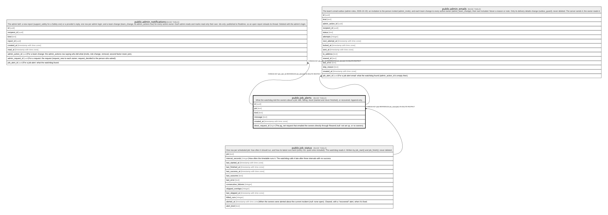

# public.job_alerts

## Description

What the watchdog told the owners about a job: late, failing, stuck (started and never finished), or recovered. Append-only.

## Columns

| Name              | Type                     | Default           | Nullable | Children                                                                                                  | Parents                                   | Comment                                                                                              |
| ----------------- | ------------------------ | ----------------- | -------- | --------------------------------------------------------------------------------------------------------- | ----------------------------------------- | ---------------------------------------------------------------------------------------------------- |
| id                | uuid                     | gen_random_uuid() | false    | [public.admin_notifications](public.admin_notifications.md) [public.admin_emails](public.admin_emails.md) |                                           |                                                                                                      |
| job               | text                     |                   | false    |                                                                                                           | [public.job_status](public.job_status.md) |                                                                                                      |
| kind              | text                     |                   | false    |                                                                                                           |                                           |                                                                                                      |
| message           | text                     |                   | false    |                                                                                                           |                                           |                                                                                                      |
| created_at        | timestamp with time zone | clock_timestamp() | false    |                                                                                                           |                                           |                                                                                                      |
| direct_request_id | bigint                   |                   | true     |                                                                                                           |                                           | The pg_net request that emailed the owners directly through Resend (null: not set up, or no owners). |

## Constraints

| Name                     | Type        | Definition                                                                                    |
| ------------------------ | ----------- | --------------------------------------------------------------------------------------------- |
| job_alerts_kind_check    | CHECK       | CHECK ((kind = ANY (ARRAY['late'::text, 'failing'::text, 'stuck'::text, 'recovered'::text]))) |
| job_alerts_message_check | CHECK       | CHECK ((char_length(message) <= 500))                                                         |
| job_alerts_job_fkey      | FOREIGN KEY | FOREIGN KEY (job) REFERENCES job_status(job) ON DELETE RESTRICT                               |
| job_alerts_pkey          | PRIMARY KEY | PRIMARY KEY (id)                                                                              |

## Indexes

| Name              | Definition                                                                        |
| ----------------- | --------------------------------------------------------------------------------- |
| job_alerts_pkey   | CREATE UNIQUE INDEX job_alerts_pkey ON public.job_alerts USING btree (id)         |
| job_alerts_recent | CREATE INDEX job_alerts_recent ON public.job_alerts USING btree (created_at DESC) |

## Triggers

| Name                            | Definition                                                                                                                                  |
| ------------------------------- | ------------------------------------------------------------------------------------------------------------------------------------------- |
| job_alerts_append_only          | CREATE TRIGGER job_alerts_append_only BEFORE DELETE OR UPDATE ON public.job_alerts FOR EACH ROW EXECUTE FUNCTION append_only_guard()        |
| job_alerts_append_only_truncate | CREATE TRIGGER job_alerts_append_only_truncate BEFORE TRUNCATE ON public.job_alerts FOR EACH STATEMENT EXECUTE FUNCTION append_only_guard() |

## Relations

---

> Generated by [tbls](https://github.com/k1LoW/tbls)
