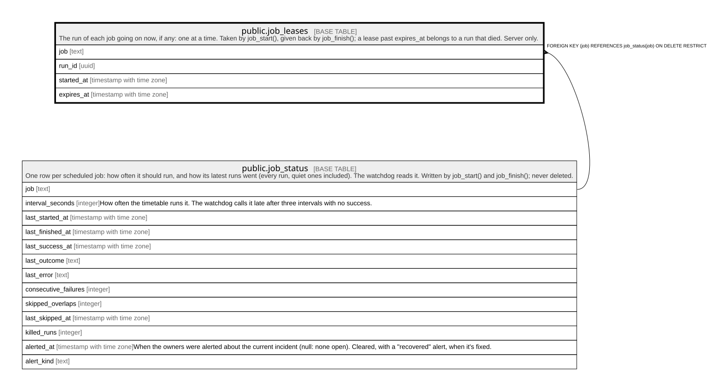

# public.job_leases

## Description

The run of each job going on now, if any: one at a time. Taken by job_start(), given back by job_finish(); a lease past expires_at belongs to a run that died. Server only.

## Columns

| Name       | Type                     | Default | Nullable | Children | Parents                                   | Comment |
| ---------- | ------------------------ | ------- | -------- | -------- | ----------------------------------------- | ------- |
| job        | text                     |         | false    |          | [public.job_status](public.job_status.md) |         |
| run_id     | uuid                     |         | false    |          |                                           |         |
| started_at | timestamp with time zone |         | false    |          |                                           |         |
| expires_at | timestamp with time zone |         | false    |          |                                           |         |

## Constraints

| Name                | Type        | Definition                                                      |
| ------------------- | ----------- | --------------------------------------------------------------- |
| job_leases_job_fkey | FOREIGN KEY | FOREIGN KEY (job) REFERENCES job_status(job) ON DELETE RESTRICT |
| job_leases_pkey     | PRIMARY KEY | PRIMARY KEY (job)                                               |

## Indexes

| Name            | Definition                                                                 |
| --------------- | -------------------------------------------------------------------------- |
| job_leases_pkey | CREATE UNIQUE INDEX job_leases_pkey ON public.job_leases USING btree (job) |

## Relations

---

> Generated by [tbls](https://github.com/k1LoW/tbls)
