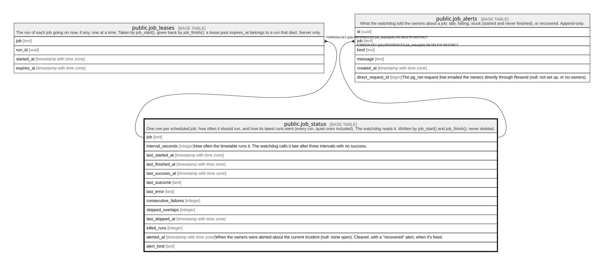

# public.job_status

## Description

One row per scheduled job: how often it should run, and how its latest runs went (every run, quiet ones included). The watchdog reads it. Written by job_start() and job_finish(); never deleted.

## Columns

| Name                 | Type                     | Default | Nullable | Children                                                                            | Parents | Comment                                                                                                                        |
| -------------------- | ------------------------ | ------- | -------- | ----------------------------------------------------------------------------------- | ------- | ------------------------------------------------------------------------------------------------------------------------------ |
| job                  | text                     |         | false    | [public.job_leases](public.job_leases.md) [public.job_alerts](public.job_alerts.md) |         |                                                                                                                                |
| interval_seconds     | integer                  |         | false    |                                                                                     |         | How often the timetable runs it. The watchdog calls it late after three intervals with no success.                             |
| last_started_at      | timestamp with time zone |         | true     |                                                                                     |         |                                                                                                                                |
| last_finished_at     | timestamp with time zone |         | true     |                                                                                     |         |                                                                                                                                |
| last_success_at      | timestamp with time zone |         | true     |                                                                                     |         |                                                                                                                                |
| last_outcome         | text                     |         | true     |                                                                                     |         |                                                                                                                                |
| last_error           | text                     |         | true     |                                                                                     |         |                                                                                                                                |
| consecutive_failures | integer                  | 0       | false    |                                                                                     |         |                                                                                                                                |
| skipped_overlaps     | integer                  | 0       | false    |                                                                                     |         |                                                                                                                                |
| last_skipped_at      | timestamp with time zone |         | true     |                                                                                     |         |                                                                                                                                |
| killed_runs          | integer                  | 0       | false    |                                                                                     |         |                                                                                                                                |
| alerted_at           | timestamp with time zone |         | true     |                                                                                     |         | When the owners were alerted about the current incident (null: none open). Cleared, with a "recovered" alert, when it's fixed. |
| alert_kind           | text                     |         | true     |                                                                                     |         |                                                                                                                                |

## Constraints

| Name                                  | Type        | Definition                                                                        |
| ------------------------------------- | ----------- | --------------------------------------------------------------------------------- |
| job_status_alert_kind_check           | CHECK       | CHECK ((alert_kind = ANY (ARRAY['late'::text, 'failing'::text, 'stuck'::text])))  |
| job_status_consecutive_failures_check | CHECK       | CHECK ((consecutive_failures >= 0))                                               |
| job_status_interval_seconds_check     | CHECK       | CHECK ((interval_seconds >= 60))                                                  |
| job_status_job_check                  | CHECK       | CHECK ((char_length(job) <= 60))                                                  |
| job_status_killed_runs_check          | CHECK       | CHECK ((killed_runs >= 0))                                                        |
| job_status_last_error_check           | CHECK       | CHECK ((char_length(last_error) <= 500))                                          |
| job_status_last_outcome_check         | CHECK       | CHECK ((last_outcome = ANY (ARRAY['ok'::text, 'failed'::text, 'skipped'::text]))) |
| job_status_skipped_overlaps_check     | CHECK       | CHECK ((skipped_overlaps >= 0))                                                   |
| job_status_pkey                       | PRIMARY KEY | PRIMARY KEY (job)                                                                 |

## Indexes

| Name            | Definition                                                                 |
| --------------- | -------------------------------------------------------------------------- |
| job_status_pkey | CREATE UNIQUE INDEX job_status_pkey ON public.job_status USING btree (job) |

## Triggers

| Name                     | Definition                                                                                                               |
| ------------------------ | ------------------------------------------------------------------------------------------------------------------------ |
| job_status_refuse_delete | CREATE TRIGGER job_status_refuse_delete BEFORE DELETE ON public.job_status FOR EACH ROW EXECUTE FUNCTION refuse_delete() |

## Relations

---

> Generated by [tbls](https://github.com/k1LoW/tbls)
