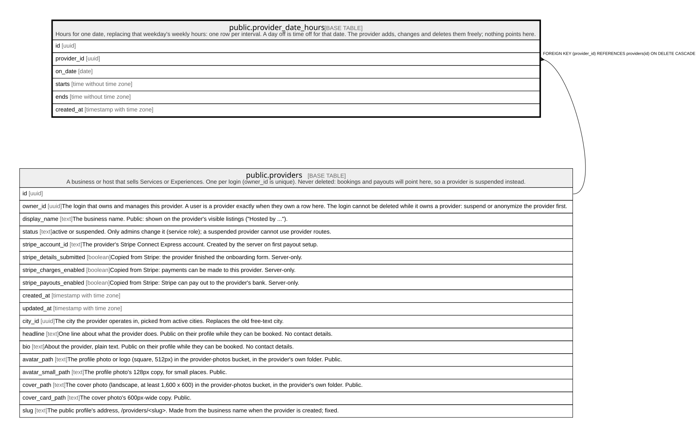

# public.provider_date_hours

## Description

Hours for one date, replacing that weekday's weekly hours: one row per interval. A day off is time off for that date. The provider adds, changes and deletes them freely; nothing points here.

## Columns

| Name        | Type                     | Default           | Nullable | Children | Parents                                 | Comment |
| ----------- | ------------------------ | ----------------- | -------- | -------- | --------------------------------------- | ------- |
| id          | uuid                     | gen_random_uuid() | false    |          |                                         |         |
| provider_id | uuid                     |                   | false    |          | [public.providers](public.providers.md) |         |
| on_date     | date                     |                   | false    |          |                                         |         |
| starts      | time without time zone   |                   | false    |          |                                         |         |
| ends        | time without time zone   |                   | false    |          |                                         |         |
| created_at  | timestamp with time zone | now()             | false    |          |                                         |         |

## Constraints

| Name                                         | Type        | Definition                                                                                     |
| -------------------------------------------- | ----------- | ---------------------------------------------------------------------------------------------- |
| provider_date_hours_ends_after_starts        | CHECK       | CHECK ((ends > starts))                                                                        |
| provider_date_hours_provider_id_fkey         | FOREIGN KEY | FOREIGN KEY (provider_id) REFERENCES providers(id) ON DELETE CASCADE                           |
| provider_date_hours_pkey                     | PRIMARY KEY | PRIMARY KEY (id)                                                                               |
| provider_date_hours_provider_id_tsrange_excl | x           | EXCLUDE USING gist (provider_id WITH =, tsrange((on_date + starts), (on_date + ends)) WITH &&) |

## Indexes

| Name                                         | Definition                                                                                                                                                      |
| -------------------------------------------- | --------------------------------------------------------------------------------------------------------------------------------------------------------------- |
| provider_date_hours_pkey                     | CREATE UNIQUE INDEX provider_date_hours_pkey ON public.provider_date_hours USING btree (id)                                                                     |
| provider_date_hours_provider_id_tsrange_excl | CREATE INDEX provider_date_hours_provider_id_tsrange_excl ON public.provider_date_hours USING gist (provider_id, tsrange((on_date + starts), (on_date + ends))) |
| provider_date_hours_provider_idx             | CREATE INDEX provider_date_hours_provider_idx ON public.provider_date_hours USING btree (provider_id, on_date)                                                  |

## Triggers

| Name                                 | Definition                                                                                                                                                                                                   |
| ------------------------------------ | ------------------------------------------------------------------------------------------------------------------------------------------------------------------------------------------------------------ |
| provider_date_hours_open_days_delete | CREATE TRIGGER provider_date_hours_open_days_delete AFTER DELETE ON public.provider_date_hours REFERENCING OLD TABLE AS changed FOR EACH STATEMENT EXECUTE FUNCTION service_open_days_changed('provider_id') |
| provider_date_hours_open_days_insert | CREATE TRIGGER provider_date_hours_open_days_insert AFTER INSERT ON public.provider_date_hours REFERENCING NEW TABLE AS changed FOR EACH STATEMENT EXECUTE FUNCTION service_open_days_changed('provider_id') |
| provider_date_hours_open_days_update | CREATE TRIGGER provider_date_hours_open_days_update AFTER UPDATE ON public.provider_date_hours REFERENCING NEW TABLE AS changed FOR EACH STATEMENT EXECUTE FUNCTION service_open_days_changed('provider_id') |

## Relations

---

> Generated by [tbls](https://github.com/k1LoW/tbls)
