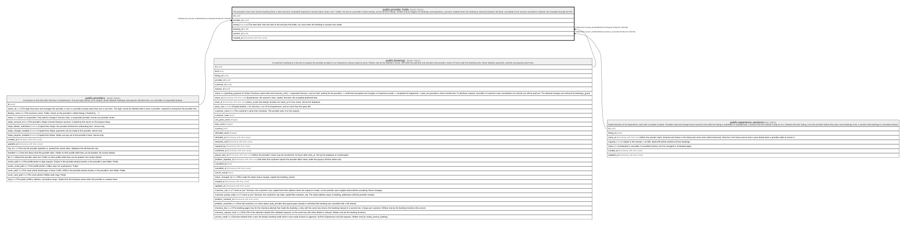

# public.provider_holds

## Description

The provider's time each Service booking (from a slot) and each scheduled Experience session takes: [start, end + buffer). No two of a provider's holds overlap, across all their listings. Written only by triggers on bookings and experience_sessions; deleted when the booking is released (expired, declined, cancelled) or the session cancelled or deleted. Not readable through the API.

## Columns

| Name        | Type                     | Default           | Nullable | Children | Parents                                                     | Comment                                                                                                   |
| ----------- | ------------------------ | ----------------- | -------- | -------- | ----------------------------------------------------------- | --------------------------------------------------------------------------------------------------------- |
| id          | uuid                     | gen_random_uuid() | false    |          |                                                             |                                                                                                           |
| provider_id | uuid                     |                   | false    |          | [public.providers](public.providers.md)                     |                                                                                                           |
| during      | tstzrange                |                   | false    |          |                                                             | The time held: from the start to the end plus the buffer, as it was when the booking or session was made. |
| booking_id  | uuid                     |                   | true     |          | [public.bookings](public.bookings.md)                       |                                                                                                           |
| session_id  | uuid                     |                   | true     |          | [public.experience_sessions](public.experience_sessions.md) |                                                                                                           |
| created_at  | timestamp with time zone | now()             | false    |          |                                                             |                                                                                                           |

## Constraints

| Name                            | Type        | Definition                                                                    |
| ------------------------------- | ----------- | ----------------------------------------------------------------------------- |
| provider_holds_check            | CHECK       | CHECK (((booking_id IS NULL) <> (session_id IS NULL)))                        |
| provider_holds_during_check     | CHECK       | CHECK ((NOT isempty(during)))                                                 |
| provider_holds_provider_id_fkey | FOREIGN KEY | FOREIGN KEY (provider_id) REFERENCES providers(id) ON DELETE CASCADE          |
| provider_holds_session_id_fkey  | FOREIGN KEY | FOREIGN KEY (session_id) REFERENCES experience_sessions(id) ON DELETE CASCADE |
| provider_holds_booking_id_fkey  | FOREIGN KEY | FOREIGN KEY (booking_id) REFERENCES bookings(id) ON DELETE CASCADE            |
| provider_holds_pkey             | PRIMARY KEY | PRIMARY KEY (id)                                                              |
| provider_holds_booking_id_key   | UNIQUE      | UNIQUE (booking_id)                                                           |
| provider_holds_session_id_key   | UNIQUE      | UNIQUE (session_id)                                                           |
| provider_holds_no_overlap       | x           | EXCLUDE USING gist (provider_id WITH =, during WITH &&)                       |

## Indexes

| Name                          | Definition                                                                                          |
| ----------------------------- | --------------------------------------------------------------------------------------------------- |
| provider_holds_pkey           | CREATE UNIQUE INDEX provider_holds_pkey ON public.provider_holds USING btree (id)                   |
| provider_holds_booking_id_key | CREATE UNIQUE INDEX provider_holds_booking_id_key ON public.provider_holds USING btree (booking_id) |
| provider_holds_session_id_key | CREATE UNIQUE INDEX provider_holds_session_id_key ON public.provider_holds USING btree (session_id) |
| provider_holds_no_overlap     | CREATE INDEX provider_holds_no_overlap ON public.provider_holds USING gist (provider_id, during)    |
| provider_holds_provider_idx   | CREATE INDEX provider_holds_provider_idx ON public.provider_holds USING gist (provider_id, during)  |

## Triggers

| Name                            | Definition                                                                                                                                                                                         |
| ------------------------------- | -------------------------------------------------------------------------------------------------------------------------------------------------------------------------------------------------- |
| provider_holds_open_days_delete | CREATE TRIGGER provider_holds_open_days_delete AFTER DELETE ON public.provider_holds REFERENCING OLD TABLE AS changed FOR EACH STATEMENT EXECUTE FUNCTION service_open_days_changed('provider_id') |
| provider_holds_open_days_insert | CREATE TRIGGER provider_holds_open_days_insert AFTER INSERT ON public.provider_holds REFERENCING NEW TABLE AS changed FOR EACH STATEMENT EXECUTE FUNCTION service_open_days_changed('provider_id') |
| provider_holds_open_days_update | CREATE TRIGGER provider_holds_open_days_update AFTER UPDATE ON public.provider_holds REFERENCING NEW TABLE AS changed FOR EACH STATEMENT EXECUTE FUNCTION service_open_days_changed('provider_id') |

## Relations

---

> Generated by [tbls](https://github.com/k1LoW/tbls)
