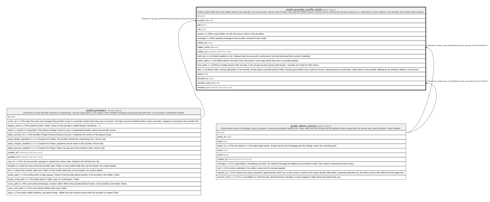

# public.provider_profile_holds

## Description

Profile content lokl's team has hidden (admin roles step 5e): one row per part, with the rule it breaks, why, and the hidden version, until the owner confirms the removal, restores it, or dismisses it. Never deleted; once decided, only its files' state changes.

## Columns

| Name              | Type                     | Default           | Nullable | Children | Parents                                         | Comment                                                                                                                                                                                                                                               |
| ----------------- | ------------------------ | ----------------- | -------- | -------- | ----------------------------------------------- | ----------------------------------------------------------------------------------------------------------------------------------------------------------------------------------------------------------------------------------------------------- |
| id                | uuid                     | gen_random_uuid() | false    |          |                                                 |                                                                                                                                                                                                                                                       |
| provider_id       | uuid                     |                   | false    |          | [public.providers](public.providers.md)         |                                                                                                                                                                                                                                                       |
| part              | text                     |                   | false    |          |                                                 |                                                                                                                                                                                                                                                       |
| rule              | text                     |                   | false    |          |                                                 |                                                                                                                                                                                                                                                       |
| reason            | text                     |                   | false    |          |                                                 | Why it was hidden, for lokl only (never shown to the provider).                                                                                                                                                                                       |
| message           | text                     |                   | true     |          |                                                 | lokl's optional message to the provider, included in their email.                                                                                                                                                                                     |
| hidden_by         | uuid                     |                   | true     |          |                                                 |                                                                                                                                                                                                                                                       |
| hidden_action_id  | uuid                     |                   | false    |          | [public.admin_actions](public.admin_actions.md) |                                                                                                                                                                                                                                                       |
| hidden_at         | timestamp with time zone | now()             | false    |          |                                                 |                                                                                                                                                                                                                                                       |
| held_text         | text                     |                   | true     |          |                                                 | A hidden headline or bio. Cleared when the removal is confirmed or the hold dismissed (the content is deleted).                                                                                                                                       |
| public_paths      | text[]                   |                   | true     |          |                                                 | A hidden photo's two files (main and small or card copy) where they were, in provider-photos.                                                                                                                                                         |
| held_paths        | text[]                   |                   | true     |          |                                                 | Where a hidden photo's files are kept, in the private provider-photos-held bucket: \<provider id\>/\<hold id\>/\<file name\>.                                                                                                                         |
| files             | text                     |                   | false    |          |                                                 | A photo's files: moving (still public, to be moved), private (kept in provider-photos-held), missing (gone before they could be moved), restoring (to be moved back), public (back on the profile), deleting (to be deleted), deleted. none for text. |
| status            | text                     | 'hidden'::text    | false    |          |                                                 |                                                                                                                                                                                                                                                       |
| decided_by        | uuid                     |                   | true     |          |                                                 |                                                                                                                                                                                                                                                       |
| decided_action_id | uuid                     |                   | true     |          | [public.admin_actions](public.admin_actions.md) |                                                                                                                                                                                                                                                       |
| decided_at        | timestamp with time zone |                   | true     |          |                                                 |                                                                                                                                                                                                                                                       |
| reminded_at       | timestamp with time zone |                   | true     |          |                                                 | When the owners were reminded that it has waited 7 days (once).                                                                                                                                                                                       |

## Constraints

| Name                                          | Type        | Definition                                                                                                                                                                                                                                                                                                  |
| --------------------------------------------- | ----------- | ----------------------------------------------------------------------------------------------------------------------------------------------------------------------------------------------------------------------------------------------------------------------------------------------------------- |
| provider_profile_holds_decided                | CHECK       | CHECK ((((status = 'hidden'::text) = (decided_at IS NULL)) AND ((status = 'hidden'::text) = (decided_action_id IS NULL))))                                                                                                                                                                                  |
| provider_profile_holds_files_check            | CHECK       | CHECK ((files = ANY (ARRAY['none'::text, 'moving'::text, 'private'::text, 'missing'::text, 'restoring'::text, 'public'::text, 'deleting'::text, 'deleted'::text])))                                                                                                                                         |
| provider_profile_holds_held_paths_check       | CHECK       | CHECK ((cardinality(held_paths) = 2))                                                                                                                                                                                                                                                                       |
| provider_profile_holds_held_text_check        | CHECK       | CHECK ((char_length(held_text) <= 1000))                                                                                                                                                                                                                                                                    |
| provider_profile_holds_message_check          | CHECK       | CHECK ((char_length(message) <= 1000))                                                                                                                                                                                                                                                                      |
| provider_profile_holds_part_check             | CHECK       | CHECK ((part = ANY (ARRAY['avatar'::text, 'cover'::text, 'headline'::text, 'bio'::text])))                                                                                                                                                                                                                  |
| provider_profile_holds_public_paths_check     | CHECK       | CHECK ((cardinality(public_paths) = 2))                                                                                                                                                                                                                                                                     |
| provider_profile_holds_reason_check           | CHECK       | CHECK (((char_length(TRIM(BOTH FROM reason)) >= 5) AND (char_length(TRIM(BOTH FROM reason)) <= 1000)))                                                                                                                                                                                                      |
| provider_profile_holds_rule_check             | CHECK       | CHECK ((rule = ANY (ARRAY['contact_details'::text, 'private_information'::text, 'abuse'::text, 'impersonation'::text, 'unsuitable_photo'::text, 'not_yours'::text])))                                                                                                                                       |
| provider_profile_holds_status_check           | CHECK       | CHECK ((status = ANY (ARRAY['hidden'::text, 'removed'::text, 'restored'::text, 'dismissed'::text])))                                                                                                                                                                                                        |
| provider_profile_holds_text_kept              | CHECK       | CHECK (((part <> ALL (ARRAY['headline'::text, 'bio'::text])) OR (status = ANY (ARRAY['removed'::text, 'dismissed'::text])) OR (held_text IS NOT NULL)))                                                                                                                                                     |
| provider_profile_holds_text_or_photo          | CHECK       | CHECK ( CASE     WHEN (part = ANY (ARRAY['headline'::text, 'bio'::text])) THEN ((files = 'none'::text) AND (public_paths IS NULL) AND (held_paths IS NULL))     ELSE ((files <> 'none'::text) AND (public_paths IS NOT NULL) AND (held_paths IS NOT NULL) AND (held_text IS NULL)) END) |
| provider_profile_holds_decided_by_fkey        | FOREIGN KEY | FOREIGN KEY (decided_by) REFERENCES auth.users(id) ON DELETE SET NULL                                                                                                                                                                                                                                       |
| provider_profile_holds_hidden_by_fkey         | FOREIGN KEY | FOREIGN KEY (hidden_by) REFERENCES auth.users(id) ON DELETE SET NULL                                                                                                                                                                                                                                        |
| provider_profile_holds_provider_id_fkey       | FOREIGN KEY | FOREIGN KEY (provider_id) REFERENCES providers(id) ON DELETE RESTRICT                                                                                                                                                                                                                                       |
| provider_profile_holds_decided_action_id_fkey | FOREIGN KEY | FOREIGN KEY (decided_action_id) REFERENCES admin_actions(id) ON DELETE RESTRICT                                                                                                                                                                                                                             |
| provider_profile_holds_hidden_action_id_fkey  | FOREIGN KEY | FOREIGN KEY (hidden_action_id) REFERENCES admin_actions(id) ON DELETE RESTRICT                                                                                                                                                                                                                              |
| provider_profile_holds_pkey                   | PRIMARY KEY | PRIMARY KEY (id)                                                                                                                                                                                                                                                                                            |

## Indexes

| Name                            | Definition                                                                                                                                                                      |
| ------------------------------- | ------------------------------------------------------------------------------------------------------------------------------------------------------------------------------- |
| provider_profile_holds_pkey     | CREATE UNIQUE INDEX provider_profile_holds_pkey ON public.provider_profile_holds USING btree (id)                                                                               |
| provider_profile_holds_open     | CREATE INDEX provider_profile_holds_open ON public.provider_profile_holds USING btree (hidden_at) WHERE (status = 'hidden'::text)                                               |
| provider_profile_holds_provider | CREATE INDEX provider_profile_holds_provider ON public.provider_profile_holds USING btree (provider_id, hidden_at)                                                              |
| provider_profile_holds_files    | CREATE INDEX provider_profile_holds_files ON public.provider_profile_holds USING btree (files) WHERE (files = ANY (ARRAY['moving'::text, 'restoring'::text, 'deleting'::text])) |

## Triggers

| Name                                  | Definition                                                                                                                                                               |
| ------------------------------------- | ------------------------------------------------------------------------------------------------------------------------------------------------------------------------ |
| provider_profile_holds_guard          | CREATE TRIGGER provider_profile_holds_guard BEFORE DELETE OR UPDATE ON public.provider_profile_holds FOR EACH ROW EXECUTE FUNCTION provider_profile_holds_guard()        |
| provider_profile_holds_guard_truncate | CREATE TRIGGER provider_profile_holds_guard_truncate BEFORE TRUNCATE ON public.provider_profile_holds FOR EACH STATEMENT EXECUTE FUNCTION provider_profile_holds_guard() |

## Relations

---

> Generated by [tbls](https://github.com/k1LoW/tbls)
