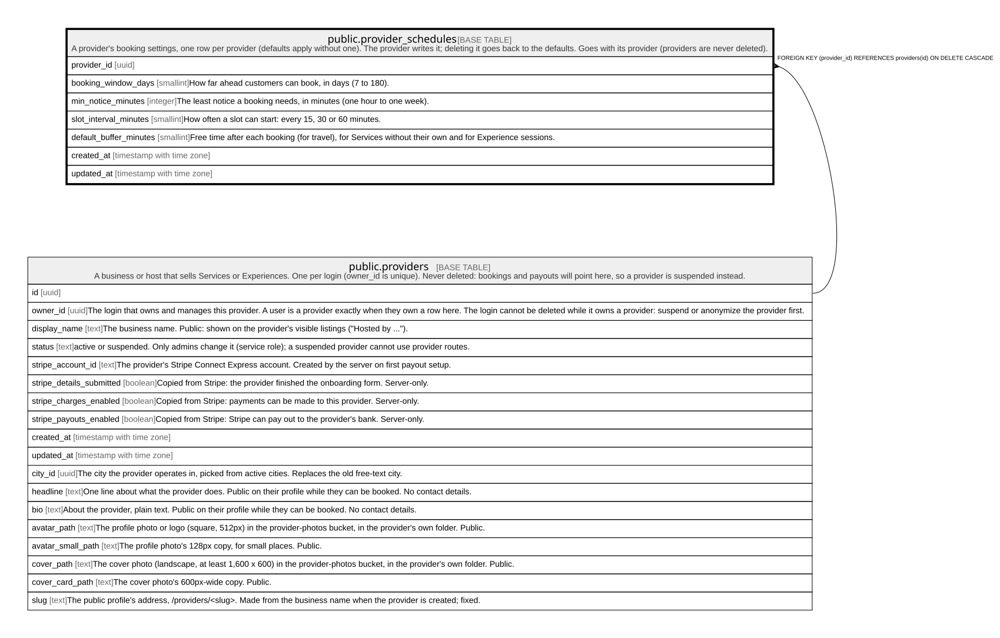

# public.provider_schedules

## Description

A provider's booking settings, one row per provider (defaults apply without one). The provider writes it; deleting it goes back to the defaults. Goes with its provider (providers are never deleted).

## Columns

| Name                   | Type                     | Default | Nullable | Children | Parents                                 | Comment                                                                                                |
| ---------------------- | ------------------------ | ------- | -------- | -------- | --------------------------------------- | ------------------------------------------------------------------------------------------------------ |
| provider_id            | uuid                     |         | false    |          | [public.providers](public.providers.md) |                                                                                                        |
| booking_window_days    | smallint                 | 60      | false    |          |                                         | How far ahead customers can book, in days (7 to 180).                                                  |
| min_notice_minutes     | integer                  | 1440    | false    |          |                                         | The least notice a booking needs, in minutes (one hour to one week).                                   |
| slot_interval_minutes  | smallint                 | 30      | false    |          |                                         | How often a slot can start: every 15, 30 or 60 minutes.                                                |
| default_buffer_minutes | smallint                 | 0       | false    |          |                                         | Free time after each booking (for travel), for Services without their own and for Experience sessions. |
| created_at             | timestamp with time zone | now()   | false    |          |                                         |                                                                                                        |
| updated_at             | timestamp with time zone | now()   | false    |          |                                         |                                                                                                        |

## Constraints

| Name                                            | Type        | Definition                                                                  |
| ----------------------------------------------- | ----------- | --------------------------------------------------------------------------- |
| provider_schedules_booking_window_days_check    | CHECK       | CHECK (((booking_window_days >= 7) AND (booking_window_days <= 180)))       |
| provider_schedules_default_buffer_minutes_check | CHECK       | CHECK (((default_buffer_minutes >= 0) AND (default_buffer_minutes <= 120))) |
| provider_schedules_min_notice_minutes_check     | CHECK       | CHECK (((min_notice_minutes >= 60) AND (min_notice_minutes <= 10080)))      |
| provider_schedules_slot_interval_minutes_check  | CHECK       | CHECK ((slot_interval_minutes = ANY (ARRAY[15, 30, 60])))                   |
| provider_schedules_provider_id_fkey             | FOREIGN KEY | FOREIGN KEY (provider_id) REFERENCES providers(id) ON DELETE CASCADE        |
| provider_schedules_pkey                         | PRIMARY KEY | PRIMARY KEY (provider_id)                                                   |

## Indexes

| Name                    | Definition                                                                                         |
| ----------------------- | -------------------------------------------------------------------------------------------------- |
| provider_schedules_pkey | CREATE UNIQUE INDEX provider_schedules_pkey ON public.provider_schedules USING btree (provider_id) |

## Triggers

| Name                                | Definition                                                                                                                                                                                                 |
| ----------------------------------- | ---------------------------------------------------------------------------------------------------------------------------------------------------------------------------------------------------------- |
| provider_schedules_open_days_delete | CREATE TRIGGER provider_schedules_open_days_delete AFTER DELETE ON public.provider_schedules REFERENCING OLD TABLE AS changed FOR EACH STATEMENT EXECUTE FUNCTION service_open_days_changed('provider_id') |
| provider_schedules_open_days_insert | CREATE TRIGGER provider_schedules_open_days_insert AFTER INSERT ON public.provider_schedules REFERENCING NEW TABLE AS changed FOR EACH STATEMENT EXECUTE FUNCTION service_open_days_changed('provider_id') |
| provider_schedules_open_days_update | CREATE TRIGGER provider_schedules_open_days_update AFTER UPDATE ON public.provider_schedules REFERENCING NEW TABLE AS changed FOR EACH STATEMENT EXECUTE FUNCTION service_open_days_changed('provider_id') |
| provider_schedules_set_updated_at   | CREATE TRIGGER provider_schedules_set_updated_at BEFORE UPDATE ON public.provider_schedules FOR EACH ROW EXECUTE FUNCTION set_updated_at()                                                                 |

## Relations

---

> Generated by [tbls](https://github.com/k1LoW/tbls)
