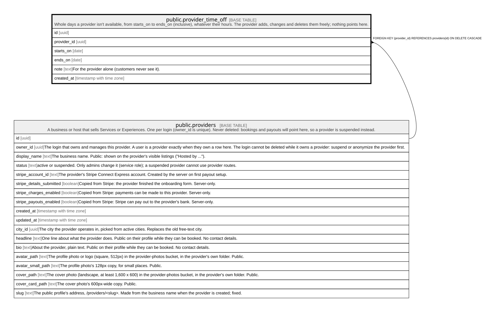

# public.provider_time_off

## Description

Whole days a provider isn't available, from starts_on to ends_on (inclusive), whatever their hours. The provider adds, changes and deletes them freely; nothing points here.

## Columns

| Name        | Type                     | Default           | Nullable | Children | Parents                                 | Comment                                          |
| ----------- | ------------------------ | ----------------- | -------- | -------- | --------------------------------------- | ------------------------------------------------ |
| id          | uuid                     | gen_random_uuid() | false    |          |                                         |                                                  |
| provider_id | uuid                     |                   | false    |          | [public.providers](public.providers.md) |                                                  |
| starts_on   | date                     |                   | false    |          |                                         |                                                  |
| ends_on     | date                     |                   | false    |          |                                         |                                                  |
| note        | text                     |                   | true     |          |                                         | For the provider alone (customers never see it). |
| created_at  | timestamp with time zone | now()             | false    |          |                                         |                                                  |

## Constraints

| Name                               | Type        | Definition                                                           |
| ---------------------------------- | ----------- | -------------------------------------------------------------------- |
| provider_time_off_check            | CHECK       | CHECK ((ends_on >= starts_on))                                       |
| provider_time_off_note_check       | CHECK       | CHECK ((char_length(note) <= 200))                                   |
| provider_time_off_provider_id_fkey | FOREIGN KEY | FOREIGN KEY (provider_id) REFERENCES providers(id) ON DELETE CASCADE |
| provider_time_off_pkey             | PRIMARY KEY | PRIMARY KEY (id)                                                     |

## Indexes

| Name                           | Definition                                                                                                   |
| ------------------------------ | ------------------------------------------------------------------------------------------------------------ |
| provider_time_off_pkey         | CREATE UNIQUE INDEX provider_time_off_pkey ON public.provider_time_off USING btree (id)                      |
| provider_time_off_provider_idx | CREATE INDEX provider_time_off_provider_idx ON public.provider_time_off USING btree (provider_id, starts_on) |

## Triggers

| Name                               | Definition                                                                                                                                                                                               |
| ---------------------------------- | -------------------------------------------------------------------------------------------------------------------------------------------------------------------------------------------------------- |
| provider_time_off_open_days_delete | CREATE TRIGGER provider_time_off_open_days_delete AFTER DELETE ON public.provider_time_off REFERENCING OLD TABLE AS changed FOR EACH STATEMENT EXECUTE FUNCTION service_open_days_changed('provider_id') |
| provider_time_off_open_days_insert | CREATE TRIGGER provider_time_off_open_days_insert AFTER INSERT ON public.provider_time_off REFERENCING NEW TABLE AS changed FOR EACH STATEMENT EXECUTE FUNCTION service_open_days_changed('provider_id') |
| provider_time_off_open_days_update | CREATE TRIGGER provider_time_off_open_days_update AFTER UPDATE ON public.provider_time_off REFERENCING NEW TABLE AS changed FOR EACH STATEMENT EXECUTE FUNCTION service_open_days_changed('provider_id') |

## Relations

---

> Generated by [tbls](https://github.com/k1LoW/tbls)
