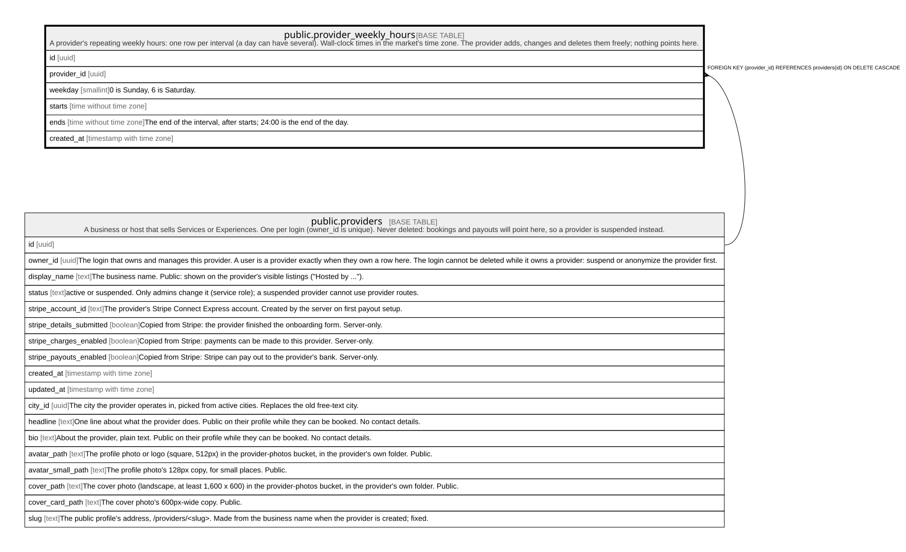

# public.provider_weekly_hours

## Description

A provider's repeating weekly hours: one row per interval (a day can have several). Wall-clock times in the market's time zone. The provider adds, changes and deletes them freely; nothing points here.

## Columns

| Name        | Type                     | Default           | Nullable | Children | Parents                                 | Comment                                                             |
| ----------- | ------------------------ | ----------------- | -------- | -------- | --------------------------------------- | ------------------------------------------------------------------- |
| id          | uuid                     | gen_random_uuid() | false    |          |                                         |                                                                     |
| provider_id | uuid                     |                   | false    |          | [public.providers](public.providers.md) |                                                                     |
| weekday     | smallint                 |                   | false    |          |                                         | 0 is Sunday, 6 is Saturday.                                         |
| starts      | time without time zone   |                   | false    |          |                                         |                                                                     |
| ends        | time without time zone   |                   | false    |          |                                         | The end of the interval, after starts; 24:00 is the end of the day. |
| created_at  | timestamp with time zone | now()             | false    |          |                                         |                                                                     |

## Constraints

| Name                                                   | Type        | Definition                                                                                                                           |
| ------------------------------------------------------ | ----------- | ------------------------------------------------------------------------------------------------------------------------------------ |
| provider_weekly_hours_ends_after_starts                | CHECK       | CHECK ((ends > starts))                                                                                                              |
| provider_weekly_hours_weekday_check                    | CHECK       | CHECK (((weekday >= 0) AND (weekday <= 6)))                                                                                          |
| provider_weekly_hours_provider_id_fkey                 | FOREIGN KEY | FOREIGN KEY (provider_id) REFERENCES providers(id) ON DELETE CASCADE                                                                 |
| provider_weekly_hours_pkey                             | PRIMARY KEY | PRIMARY KEY (id)                                                                                                                     |
| provider_weekly_hours_provider_id_weekday_tsrange_excl | x           | EXCLUDE USING gist (provider_id WITH =, weekday WITH =, tsrange(('2000-01-02'::date + starts), ('2000-01-02'::date + ends)) WITH &&) |

## Indexes

| Name                                                   | Definition                                                                                                                                                                                                 |
| ------------------------------------------------------ | ---------------------------------------------------------------------------------------------------------------------------------------------------------------------------------------------------------- |
| provider_weekly_hours_pkey                             | CREATE UNIQUE INDEX provider_weekly_hours_pkey ON public.provider_weekly_hours USING btree (id)                                                                                                            |
| provider_weekly_hours_provider_id_weekday_tsrange_excl | CREATE INDEX provider_weekly_hours_provider_id_weekday_tsrange_excl ON public.provider_weekly_hours USING gist (provider_id, weekday, tsrange(('2000-01-02'::date + starts), ('2000-01-02'::date + ends))) |
| provider_weekly_hours_provider_idx                     | CREATE INDEX provider_weekly_hours_provider_idx ON public.provider_weekly_hours USING btree (provider_id, weekday)                                                                                         |

## Triggers

| Name                                   | Definition                                                                                                                                                                                                       |
| -------------------------------------- | ---------------------------------------------------------------------------------------------------------------------------------------------------------------------------------------------------------------- |
| provider_weekly_hours_open_days_delete | CREATE TRIGGER provider_weekly_hours_open_days_delete AFTER DELETE ON public.provider_weekly_hours REFERENCING OLD TABLE AS changed FOR EACH STATEMENT EXECUTE FUNCTION service_open_days_changed('provider_id') |
| provider_weekly_hours_open_days_insert | CREATE TRIGGER provider_weekly_hours_open_days_insert AFTER INSERT ON public.provider_weekly_hours REFERENCING NEW TABLE AS changed FOR EACH STATEMENT EXECUTE FUNCTION service_open_days_changed('provider_id') |
| provider_weekly_hours_open_days_update | CREATE TRIGGER provider_weekly_hours_open_days_update AFTER UPDATE ON public.provider_weekly_hours REFERENCING NEW TABLE AS changed FOR EACH STATEMENT EXECUTE FUNCTION service_open_days_changed('provider_id') |

## Relations

---

> Generated by [tbls](https://github.com/k1LoW/tbls)
