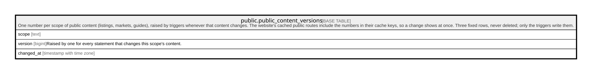

# public.public_content_versions

## Description

One number per scope of public content (listings, markets, guides), raised by triggers whenever that content changes. The website's cached public routes include the numbers in their cache keys, so a change shows at once. Three fixed rows, never deleted; only the triggers write them.

## Columns

| Name       | Type                     | Default | Nullable | Children | Parents | Comment                                                              |
| ---------- | ------------------------ | ------- | -------- | -------- | ------- | -------------------------------------------------------------------- |
| scope      | text                     |         | false    |          |         |                                                                      |
| version    | bigint                   | 0       | false    |          |         | Raised by one for every statement that changes this scope's content. |
| changed_at | timestamp with time zone | now()   | false    |          |         |                                                                      |

## Constraints

| Name                                | Type        | Definition                                                                       |
| ----------------------------------- | ----------- | -------------------------------------------------------------------------------- |
| public_content_versions_scope_check | CHECK       | CHECK ((scope = ANY (ARRAY['listings'::text, 'markets'::text, 'guides'::text]))) |
| public_content_versions_pkey        | PRIMARY KEY | PRIMARY KEY (scope)                                                              |

## Indexes

| Name                         | Definition                                                                                             |
| ---------------------------- | ------------------------------------------------------------------------------------------------------ |
| public_content_versions_pkey | CREATE UNIQUE INDEX public_content_versions_pkey ON public.public_content_versions USING btree (scope) |

## Relations

---

> Generated by [tbls](https://github.com/k1LoW/tbls)
