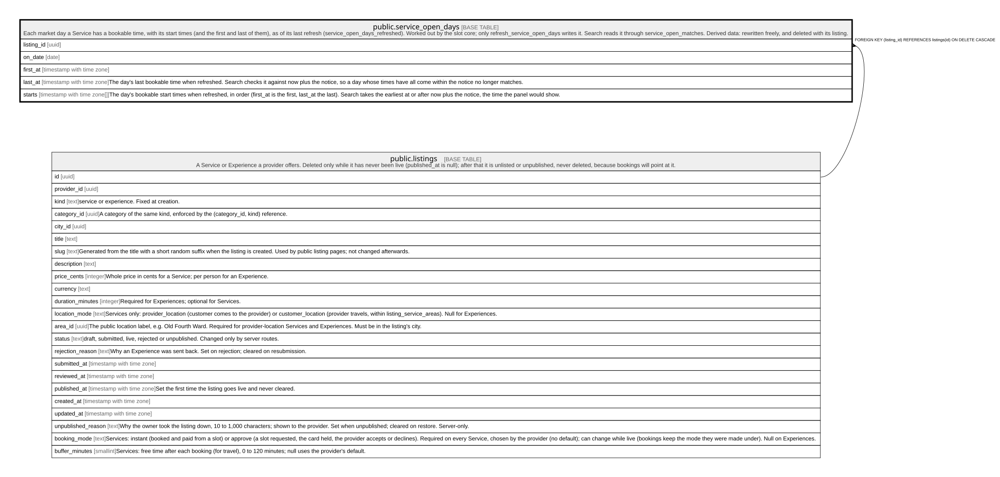

# public.service_open_days

## Description

Each market day a Service has a bookable time, with its start times (and the first and last of them), as of its last refresh (service_open_days_refreshed). Worked out by the slot core; only refresh_service_open_days writes it. Search reads it through service_open_matches. Derived data: rewritten freely, and deleted with its listing.

## Columns

| Name       | Type                       | Default | Nullable | Children | Parents                               | Comment                                                                                                                                                                                      |
| ---------- | -------------------------- | ------- | -------- | -------- | ------------------------------------- | -------------------------------------------------------------------------------------------------------------------------------------------------------------------------------------------- |
| listing_id | uuid                       |         | false    |          | [public.listings](public.listings.md) |                                                                                                                                                                                              |
| on_date    | date                       |         | false    |          |                                       |                                                                                                                                                                                              |
| first_at   | timestamp with time zone   |         | false    |          |                                       |                                                                                                                                                                                              |
| last_at    | timestamp with time zone   |         | false    |          |                                       | The day's last bookable time when refreshed. Search checks it against now plus the notice, so a day whose times have all come within the notice no longer matches.                           |
| starts     | timestamp with time zone[] |         | false    |          |                                       | The day's bookable start times when refreshed, in order (first_at is the first, last_at the last). Search takes the earliest at or after now plus the notice, the time the panel would show. |

## Constraints

| Name                              | Type        | Definition                                                                                                  |
| --------------------------------- | ----------- | ----------------------------------------------------------------------------------------------------------- |
| service_open_days_check           | CHECK       | CHECK ((last_at >= first_at))                                                                               |
| service_open_days_starts          | CHECK       | CHECK (((cardinality(starts) >= 1) AND (starts[1] = first_at) AND (starts[cardinality(starts)] = last_at))) |
| service_open_days_listing_id_fkey | FOREIGN KEY | FOREIGN KEY (listing_id) REFERENCES listings(id) ON DELETE CASCADE                                          |
| service_open_days_pkey            | PRIMARY KEY | PRIMARY KEY (listing_id, on_date)                                                                           |

## Indexes

| Name                   | Definition                                                                                               |
| ---------------------- | -------------------------------------------------------------------------------------------------------- |
| service_open_days_pkey | CREATE UNIQUE INDEX service_open_days_pkey ON public.service_open_days USING btree (listing_id, on_date) |

## Relations

---

> Generated by [tbls](https://github.com/k1LoW/tbls)
