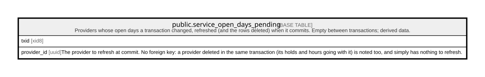

# public.service_open_days_pending

## Description

Providers whose open days a transaction changed, refreshed (and the rows deleted) when it commits. Empty between transactions; derived data.

## Columns

| Name        | Type | Default              | Nullable | Children | Parents | Comment                                                                                                                                                                            |
| ----------- | ---- | -------------------- | -------- | -------- | ------- | ---------------------------------------------------------------------------------------------------------------------------------------------------------------------------------- |
| txid        | xid8 | pg_current_xact_id() | false    |          |         |                                                                                                                                                                                    |
| provider_id | uuid |                      | false    |          |         | The provider to refresh at commit. No foreign key: a provider deleted in the same transaction (its holds and hours going with it) is noted too, and simply has nothing to refresh. |

## Constraints

| Name                              | Type        | Definition                                                                                                                                                                                         |
| --------------------------------- | ----------- | -------------------------------------------------------------------------------------------------------------------------------------------------------------------------------------------------- |
| service_open_days_pending_refresh | TRIGGER     | CREATE CONSTRAINT TRIGGER service_open_days_pending_refresh AFTER INSERT ON public.service_open_days_pending DEFERRABLE INITIALLY DEFERRED FOR EACH ROW EXECUTE FUNCTION service_open_days_flush() |
| service_open_days_pending_pkey    | PRIMARY KEY | PRIMARY KEY (txid, provider_id)                                                                                                                                                                    |

## Indexes

| Name                           | Definition                                                                                                             |
| ------------------------------ | ---------------------------------------------------------------------------------------------------------------------- |
| service_open_days_pending_pkey | CREATE UNIQUE INDEX service_open_days_pending_pkey ON public.service_open_days_pending USING btree (txid, provider_id) |

## Triggers

| Name                              | Definition                                                                                                                                                                                         |
| --------------------------------- | -------------------------------------------------------------------------------------------------------------------------------------------------------------------------------------------------- |
| service_open_days_pending_refresh | CREATE CONSTRAINT TRIGGER service_open_days_pending_refresh AFTER INSERT ON public.service_open_days_pending DEFERRABLE INITIALLY DEFERRED FOR EACH ROW EXECUTE FUNCTION service_open_days_flush() |

## Relations

---

> Generated by [tbls](https://github.com/k1LoW/tbls)
