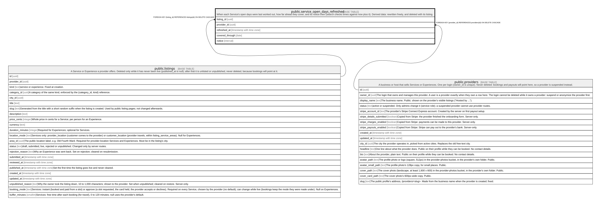

# public.service_open_days_refreshed

## Description

When each Service's open days were last worked out, how far ahead they cover, and its notice then (search checks times against now plus it). Derived data: rewritten freely, and deleted with its listing.

## Columns

| Name            | Type                     | Default | Nullable | Children | Parents                                 | Comment |
| --------------- | ------------------------ | ------- | -------- | -------- | --------------------------------------- | ------- |
| listing_id      | uuid                     |         | false    |          | [public.listings](public.listings.md)   |         |
| provider_id     | uuid                     |         | false    |          | [public.providers](public.providers.md) |         |
| refreshed_at    | timestamp with time zone |         | false    |          |                                         |         |
| covered_through | date                     |         | false    |          |                                         |         |
| notice          | interval                 |         | false    |          |                                         |         |

## Constraints

| Name                                         | Type        | Definition                                                           |
| -------------------------------------------- | ----------- | -------------------------------------------------------------------- |
| service_open_days_refreshed_provider_id_fkey | FOREIGN KEY | FOREIGN KEY (provider_id) REFERENCES providers(id) ON DELETE CASCADE |
| service_open_days_refreshed_listing_id_fkey  | FOREIGN KEY | FOREIGN KEY (listing_id) REFERENCES listings(id) ON DELETE CASCADE   |
| service_open_days_refreshed_pkey             | PRIMARY KEY | PRIMARY KEY (listing_id)                                             |

## Indexes

| Name                                 | Definition                                                                                                          |
| ------------------------------------ | ------------------------------------------------------------------------------------------------------------------- |
| service_open_days_refreshed_pkey     | CREATE UNIQUE INDEX service_open_days_refreshed_pkey ON public.service_open_days_refreshed USING btree (listing_id) |
| service_open_days_refreshed_provider | CREATE INDEX service_open_days_refreshed_provider ON public.service_open_days_refreshed USING btree (provider_id)   |

## Relations

---

> Generated by [tbls](https://github.com/k1LoW/tbls)
