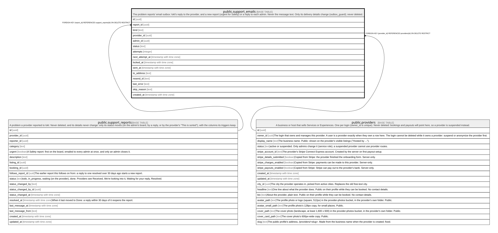

# public.support_emails

## Description

The problem reports' email outbox: lokl's reply to the provider, and a new report (urgent for Safety) or a reply to each admin. Never the message text. Only its delivery details change (outbox_guard); never deleted.

## Columns

| Name            | Type                     | Default           | Nullable | Children | Parents                                             | Comment |
| --------------- | ------------------------ | ----------------- | -------- | -------- | --------------------------------------------------- | ------- |
| id              | uuid                     | gen_random_uuid() | false    |          |                                                     |         |
| report_id       | uuid                     |                   | false    |          | [public.support_reports](public.support_reports.md) |         |
| kind            | text                     |                   | false    |          |                                                     |         |
| provider_id     | uuid                     |                   | true     |          | [public.providers](public.providers.md)             |         |
| admin_id        | uuid                     |                   | true     |          |                                                     |         |
| status          | text                     | 'pending'::text   | false    |          |                                                     |         |
| attempts        | integer                  | 0                 | false    |          |                                                     |         |
| next_attempt_at | timestamp with time zone | now()             | false    |          |                                                     |         |
| locked_at       | timestamp with time zone |                   | true     |          |                                                     |         |
| sent_at         | timestamp with time zone |                   | true     |          |                                                     |         |
| to_address      | text                     |                   | true     |          |                                                     |         |
| resend_id       | text                     |                   | true     |          |                                                     |         |
| last_error      | text                     |                   | true     |          |                                                     |         |
| skip_reason     | text                     |                   | true     |          |                                                     |         |
| created_at      | timestamp with time zone | clock_timestamp() | false    |          |                                                     |         |

## Constraints

| Name                             | Type        | Definition                                                                                                                                         |
| -------------------------------- | ----------- | -------------------------------------------------------------------------------------------------------------------------------------------------- |
| support_emails_attempts_check    | CHECK       | CHECK ((attempts >= 0))                                                                                                                            |
| support_emails_check             | CHECK       | CHECK (((kind = 'provider_support_reply'::text) = (provider_id IS NOT NULL)))                                                                      |
| support_emails_check1            | CHECK       | CHECK (((kind <> 'provider_support_reply'::text) = (admin_id IS NOT NULL)))                                                                        |
| support_emails_kind_check        | CHECK       | CHECK ((kind = ANY (ARRAY['provider_support_reply'::text, 'admin_support_new'::text, 'admin_support_safety'::text, 'admin_support_reply'::text]))) |
| support_emails_last_error_check  | CHECK       | CHECK ((char_length(last_error) <= 500))                                                                                                           |
| support_emails_skip_reason_check | CHECK       | CHECK ((char_length(skip_reason) <= 200))                                                                                                          |
| support_emails_status_check      | CHECK       | CHECK ((status = ANY (ARRAY['pending'::text, 'sending'::text, 'sent'::text, 'skipped'::text, 'failed'::text])))                                    |
| support_emails_to_address_check  | CHECK       | CHECK ((char_length(to_address) <= 320))                                                                                                           |
| support_emails_provider_id_fkey  | FOREIGN KEY | FOREIGN KEY (provider_id) REFERENCES providers(id) ON DELETE RESTRICT                                                                              |
| support_emails_report_id_fkey    | FOREIGN KEY | FOREIGN KEY (report_id) REFERENCES support_reports(id) ON DELETE RESTRICT                                                                          |
| support_emails_pkey              | PRIMARY KEY | PRIMARY KEY (id)                                                                                                                                   |

## Indexes

| Name                | Definition                                                                                                                                           |
| ------------------- | ---------------------------------------------------------------------------------------------------------------------------------------------------- |
| support_emails_pkey | CREATE UNIQUE INDEX support_emails_pkey ON public.support_emails USING btree (id)                                                                    |
| support_emails_due  | CREATE INDEX support_emails_due ON public.support_emails USING btree (next_attempt_at) WHERE (status = ANY (ARRAY['pending'::text, 'failed'::text])) |

## Triggers

| Name                                 | Definition                                                                                                                                      |
| ------------------------------------ | ----------------------------------------------------------------------------------------------------------------------------------------------- |
| support_emails_outbox_guard          | CREATE TRIGGER support_emails_outbox_guard BEFORE DELETE OR UPDATE ON public.support_emails FOR EACH ROW EXECUTE FUNCTION outbox_guard()        |
| support_emails_outbox_guard_truncate | CREATE TRIGGER support_emails_outbox_guard_truncate BEFORE TRUNCATE ON public.support_emails FOR EACH STATEMENT EXECUTE FUNCTION outbox_guard() |

## Relations

---

> Generated by [tbls](https://github.com/k1LoW/tbls)
