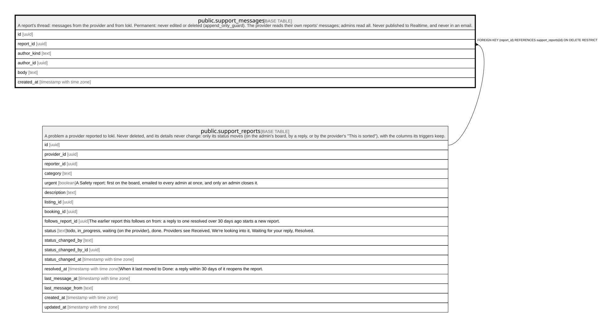

# public.support_messages

## Description

A report's thread: messages from the provider and from lokl. Permanent: never edited or deleted (append_only_guard). The provider reads their own reports' messages; admins read all. Never published to Realtime, and never in an email.

## Columns

| Name        | Type                     | Default           | Nullable | Children | Parents                                             | Comment |
| ----------- | ------------------------ | ----------------- | -------- | -------- | --------------------------------------------------- | ------- |
| id          | uuid                     | gen_random_uuid() | false    |          |                                                     |         |
| report_id   | uuid                     |                   | false    |          | [public.support_reports](public.support_reports.md) |         |
| author_kind | text                     | 'provider'::text  | false    |          |                                                     |         |
| author_id   | uuid                     | auth.uid()        | true     |          |                                                     |         |
| body        | text                     |                   | false    |          |                                                     |         |
| created_at  | timestamp with time zone | now()             | false    |          |                                                     |         |

## Constraints

| Name                               | Type        | Definition                                                                       |
| ---------------------------------- | ----------- | -------------------------------------------------------------------------------- |
| support_messages_author_kind_check | CHECK       | CHECK ((author_kind = ANY (ARRAY['provider'::text, 'admin'::text])))             |
| support_messages_body_check        | CHECK       | CHECK (((char_length(btrim(body)) >= 1) AND (char_length(btrim(body)) <= 5000))) |
| support_messages_author_id_fkey    | FOREIGN KEY | FOREIGN KEY (author_id) REFERENCES auth.users(id) ON DELETE SET NULL             |
| support_messages_report_id_fkey    | FOREIGN KEY | FOREIGN KEY (report_id) REFERENCES support_reports(id) ON DELETE RESTRICT        |
| support_messages_pkey              | PRIMARY KEY | PRIMARY KEY (id)                                                                 |

## Indexes

| Name                    | Definition                                                                                          |
| ----------------------- | --------------------------------------------------------------------------------------------------- |
| support_messages_pkey   | CREATE UNIQUE INDEX support_messages_pkey ON public.support_messages USING btree (id)               |
| support_messages_report | CREATE INDEX support_messages_report ON public.support_messages USING btree (report_id, created_at) |

## Triggers

| Name                                  | Definition                                                                                                                                                  |
| ------------------------------------- | ----------------------------------------------------------------------------------------------------------------------------------------------------------- |
| support_messages_append_only          | CREATE TRIGGER support_messages_append_only BEFORE DELETE OR UPDATE ON public.support_messages FOR EACH ROW EXECUTE FUNCTION append_only_guard('author_id') |
| support_messages_append_only_truncate | CREATE TRIGGER support_messages_append_only_truncate BEFORE TRUNCATE ON public.support_messages FOR EACH STATEMENT EXECUTE FUNCTION append_only_guard()     |
| support_messages_check                | CREATE TRIGGER support_messages_check BEFORE INSERT ON public.support_messages FOR EACH ROW EXECUTE FUNCTION support_messages_check()                       |
| support_messages_notify               | CREATE TRIGGER support_messages_notify AFTER INSERT ON public.support_messages FOR EACH ROW EXECUTE FUNCTION support_notify()                               |

## Relations

---

> Generated by [tbls](https://github.com/k1LoW/tbls)
