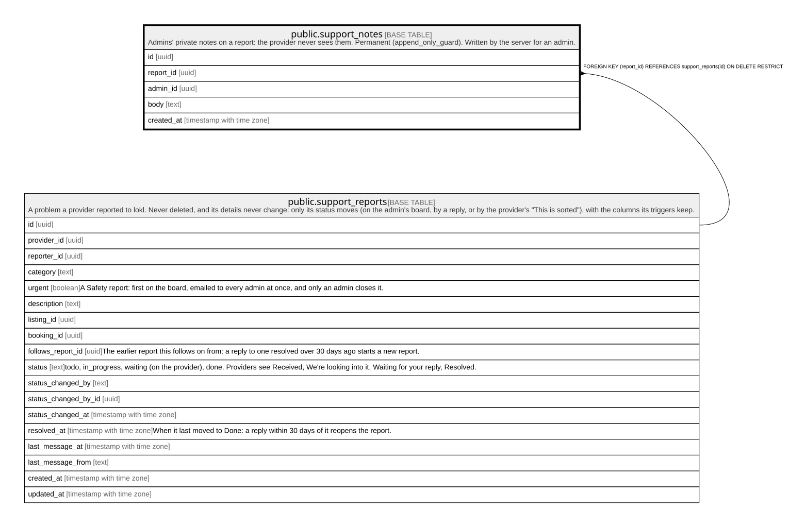

# public.support_notes

## Description

Admins' private notes on a report: the provider never sees them. Permanent (append_only_guard). Written by the server for an admin.

## Columns

| Name       | Type                     | Default           | Nullable | Children | Parents                                             | Comment |
| ---------- | ------------------------ | ----------------- | -------- | -------- | --------------------------------------------------- | ------- |
| id         | uuid                     | gen_random_uuid() | false    |          |                                                     |         |
| report_id  | uuid                     |                   | false    |          | [public.support_reports](public.support_reports.md) |         |
| admin_id   | uuid                     |                   | true     |          |                                                     |         |
| body       | text                     |                   | false    |          |                                                     |         |
| created_at | timestamp with time zone | now()             | false    |          |                                                     |         |

## Constraints

| Name                         | Type        | Definition                                                                       |
| ---------------------------- | ----------- | -------------------------------------------------------------------------------- |
| support_notes_body_check     | CHECK       | CHECK (((char_length(btrim(body)) >= 1) AND (char_length(btrim(body)) <= 5000))) |
| support_notes_admin_id_fkey  | FOREIGN KEY | FOREIGN KEY (admin_id) REFERENCES auth.users(id) ON DELETE SET NULL              |
| support_notes_report_id_fkey | FOREIGN KEY | FOREIGN KEY (report_id) REFERENCES support_reports(id) ON DELETE RESTRICT        |
| support_notes_pkey           | PRIMARY KEY | PRIMARY KEY (id)                                                                 |

## Indexes

| Name                 | Definition                                                                                    |
| -------------------- | --------------------------------------------------------------------------------------------- |
| support_notes_pkey   | CREATE UNIQUE INDEX support_notes_pkey ON public.support_notes USING btree (id)               |
| support_notes_report | CREATE INDEX support_notes_report ON public.support_notes USING btree (report_id, created_at) |

## Triggers

| Name                               | Definition                                                                                                                                           |
| ---------------------------------- | ---------------------------------------------------------------------------------------------------------------------------------------------------- |
| support_notes_append_only          | CREATE TRIGGER support_notes_append_only BEFORE DELETE OR UPDATE ON public.support_notes FOR EACH ROW EXECUTE FUNCTION append_only_guard('admin_id') |
| support_notes_append_only_truncate | CREATE TRIGGER support_notes_append_only_truncate BEFORE TRUNCATE ON public.support_notes FOR EACH STATEMENT EXECUTE FUNCTION append_only_guard()    |

## Relations

---

> Generated by [tbls](https://github.com/k1LoW/tbls)
