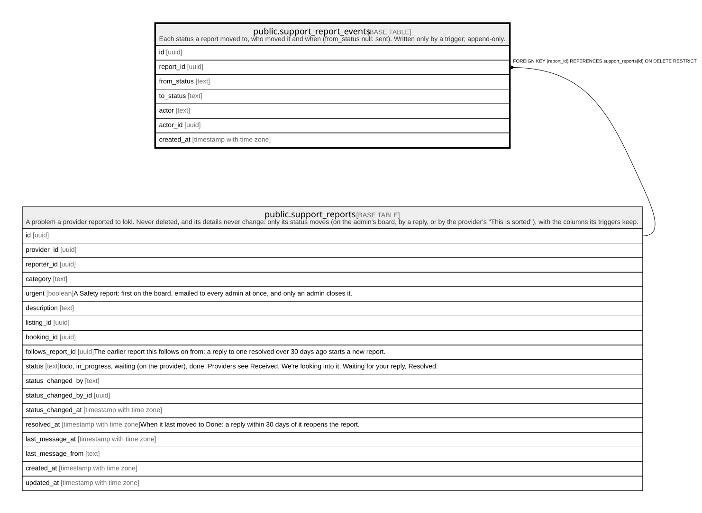

# public.support_report_events

## Description

Each status a report moved to, who moved it and when (from_status null: sent). Written only by a trigger; append-only.

## Columns

| Name        | Type                     | Default           | Nullable | Children | Parents                                             | Comment |
| ----------- | ------------------------ | ----------------- | -------- | -------- | --------------------------------------------------- | ------- |
| id          | uuid                     | gen_random_uuid() | false    |          |                                                     |         |
| report_id   | uuid                     |                   | false    |          | [public.support_reports](public.support_reports.md) |         |
| from_status | text                     |                   | true     |          |                                                     |         |
| to_status   | text                     |                   | false    |          |                                                     |         |
| actor       | text                     |                   | false    |          |                                                     |         |
| actor_id    | uuid                     |                   | true     |          |                                                     |         |
| created_at  | timestamp with time zone | now()             | false    |          |                                                     |         |

## Constraints

| Name                                    | Type        | Definition                                                                                            |
| --------------------------------------- | ----------- | ----------------------------------------------------------------------------------------------------- |
| support_report_events_actor_check       | CHECK       | CHECK ((actor = ANY (ARRAY['provider'::text, 'admin'::text, 'system'::text])))                        |
| support_report_events_from_status_check | CHECK       | CHECK ((from_status = ANY (ARRAY['todo'::text, 'in_progress'::text, 'waiting'::text, 'done'::text]))) |
| support_report_events_to_status_check   | CHECK       | CHECK ((to_status = ANY (ARRAY['todo'::text, 'in_progress'::text, 'waiting'::text, 'done'::text])))   |
| support_report_events_actor_id_fkey     | FOREIGN KEY | FOREIGN KEY (actor_id) REFERENCES auth.users(id) ON DELETE SET NULL                                   |
| support_report_events_report_id_fkey    | FOREIGN KEY | FOREIGN KEY (report_id) REFERENCES support_reports(id) ON DELETE RESTRICT                             |
| support_report_events_pkey              | PRIMARY KEY | PRIMARY KEY (id)                                                                                      |

## Indexes

| Name                         | Definition                                                                                                    |
| ---------------------------- | ------------------------------------------------------------------------------------------------------------- |
| support_report_events_pkey   | CREATE UNIQUE INDEX support_report_events_pkey ON public.support_report_events USING btree (id)               |
| support_report_events_report | CREATE INDEX support_report_events_report ON public.support_report_events USING btree (report_id, created_at) |

## Triggers

| Name                                       | Definition                                                                                                                                                           |
| ------------------------------------------ | -------------------------------------------------------------------------------------------------------------------------------------------------------------------- |
| support_report_events_append_only          | CREATE TRIGGER support_report_events_append_only BEFORE DELETE OR UPDATE ON public.support_report_events FOR EACH ROW EXECUTE FUNCTION append_only_guard('actor_id') |
| support_report_events_append_only_truncate | CREATE TRIGGER support_report_events_append_only_truncate BEFORE TRUNCATE ON public.support_report_events FOR EACH STATEMENT EXECUTE FUNCTION append_only_guard()    |

## Relations

---

> Generated by [tbls](https://github.com/k1LoW/tbls)
