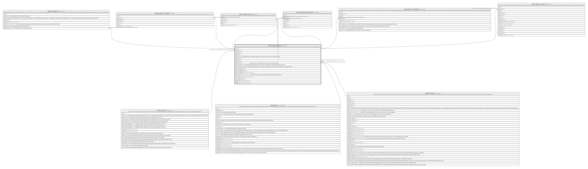

# public.support_reports

## Description

A problem a provider reported to lokl. Never deleted, and its details never change: only its status moves (on the admin's board, by a reply, or by the provider's "This is sorted"), with the columns its triggers keep.

## Columns

| Name                 | Type                     | Default               | Nullable | Extra Definition                                       | Children                                                                                                                                                                                                                                                                                                                                                                                | Parents                                             | Comment                                                                                                                              |
| -------------------- | ------------------------ | --------------------- | -------- | ------------------------------------------------------ | --------------------------------------------------------------------------------------------------------------------------------------------------------------------------------------------------------------------------------------------------------------------------------------------------------------------------------------------------------------------------------------- | --------------------------------------------------- | ------------------------------------------------------------------------------------------------------------------------------------ |
| id                   | uuid                     | gen_random_uuid()     | false    |                                                        | [public.notifications](public.notifications.md) [public.support_reports](public.support_reports.md) [public.support_messages](public.support_messages.md) [public.support_notes](public.support_notes.md) [public.support_report_events](public.support_report_events.md) [public.admin_notifications](public.admin_notifications.md) [public.support_emails](public.support_emails.md) |                                                     |                                                                                                                                      |
| provider_id          | uuid                     | current_provider_id() | false    |                                                        |                                                                                                                                                                                                                                                                                                                                                                                         | [public.providers](public.providers.md)             |                                                                                                                                      |
| reporter_id          | uuid                     | auth.uid()            | true     |                                                        |                                                                                                                                                                                                                                                                                                                                                                                         |                                                     |                                                                                                                                      |
| category             | text                     |                       | false    |                                                        |                                                                                                                                                                                                                                                                                                                                                                                         |                                                     |                                                                                                                                      |
| urgent               | boolean                  |                       | true     | GENERATED ALWAYS AS (category = 'safety'::text) STORED |                                                                                                                                                                                                                                                                                                                                                                                         |                                                     | A Safety report: first on the board, emailed to every admin at once, and only an admin closes it.                                    |
| description          | text                     |                       | false    |                                                        |                                                                                                                                                                                                                                                                                                                                                                                         |                                                     |                                                                                                                                      |
| listing_id           | uuid                     |                       | true     |                                                        |                                                                                                                                                                                                                                                                                                                                                                                         | [public.listings](public.listings.md)               |                                                                                                                                      |
| booking_id           | uuid                     |                       | true     |                                                        |                                                                                                                                                                                                                                                                                                                                                                                         | [public.bookings](public.bookings.md)               |                                                                                                                                      |
| follows_report_id    | uuid                     |                       | true     |                                                        |                                                                                                                                                                                                                                                                                                                                                                                         | [public.support_reports](public.support_reports.md) | The earlier report this follows on from: a reply to one resolved over 30 days ago starts a new report.                               |
| status               | text                     | 'todo'::text          | false    |                                                        |                                                                                                                                                                                                                                                                                                                                                                                         |                                                     | todo, in_progress, waiting (on the provider), done. Providers see Received, We're looking into it, Waiting for your reply, Resolved. |
| status_changed_by    | text                     | 'provider'::text      | false    |                                                        |                                                                                                                                                                                                                                                                                                                                                                                         |                                                     |                                                                                                                                      |
| status_changed_by_id | uuid                     |                       | true     |                                                        |                                                                                                                                                                                                                                                                                                                                                                                         |                                                     |                                                                                                                                      |
| status_changed_at    | timestamp with time zone | now()                 | false    |                                                        |                                                                                                                                                                                                                                                                                                                                                                                         |                                                     |                                                                                                                                      |
| resolved_at          | timestamp with time zone |                       | true     |                                                        |                                                                                                                                                                                                                                                                                                                                                                                         |                                                     | When it last moved to Done: a reply within 30 days of it reopens the report.                                                         |
| last_message_at      | timestamp with time zone | now()                 | false    |                                                        |                                                                                                                                                                                                                                                                                                                                                                                         |                                                     |                                                                                                                                      |
| last_message_from    | text                     | 'provider'::text      | false    |                                                        |                                                                                                                                                                                                                                                                                                                                                                                         |                                                     |                                                                                                                                      |
| created_at           | timestamp with time zone | now()                 | false    |                                                        |                                                                                                                                                                                                                                                                                                                                                                                         |                                                     |                                                                                                                                      |
| updated_at           | timestamp with time zone | now()                 | false    |                                                        |                                                                                                                                                                                                                                                                                                                                                                                         |                                                     |                                                                                                                                      |

## Constraints

| Name                                      | Type        | Definition                                                                                                                           |
| ----------------------------------------- | ----------- | ------------------------------------------------------------------------------------------------------------------------------------ |
| support_reports_category_check            | CHECK       | CHECK ((category = ANY (ARRAY['booking'::text, 'payments'::text, 'listing'::text, 'website'::text, 'safety'::text, 'other'::text]))) |
| support_reports_check                     | CHECK       | CHECK (((status = 'done'::text) = (resolved_at IS NOT NULL)))                                                                        |
| support_reports_description_check         | CHECK       | CHECK (((char_length(btrim(description)) >= 20) AND (char_length(btrim(description)) <= 5000)))                                      |
| support_reports_last_message_from_check   | CHECK       | CHECK ((last_message_from = ANY (ARRAY['provider'::text, 'admin'::text])))                                                           |
| support_reports_status_changed_by_check   | CHECK       | CHECK ((status_changed_by = ANY (ARRAY['provider'::text, 'admin'::text, 'system'::text])))                                           |
| support_reports_status_check              | CHECK       | CHECK ((status = ANY (ARRAY['todo'::text, 'in_progress'::text, 'waiting'::text, 'done'::text])))                                     |
| support_reports_reporter_id_fkey          | FOREIGN KEY | FOREIGN KEY (reporter_id) REFERENCES auth.users(id) ON DELETE SET NULL                                                               |
| support_reports_status_changed_by_id_fkey | FOREIGN KEY | FOREIGN KEY (status_changed_by_id) REFERENCES auth.users(id) ON DELETE SET NULL                                                      |
| support_reports_provider_id_fkey          | FOREIGN KEY | FOREIGN KEY (provider_id) REFERENCES providers(id) ON DELETE RESTRICT                                                                |
| support_reports_listing_id_fkey           | FOREIGN KEY | FOREIGN KEY (listing_id) REFERENCES listings(id) ON DELETE RESTRICT                                                                  |
| support_reports_booking_id_fkey           | FOREIGN KEY | FOREIGN KEY (booking_id) REFERENCES bookings(id) ON DELETE RESTRICT                                                                  |
| support_reports_follows_report_id_fkey    | FOREIGN KEY | FOREIGN KEY (follows_report_id) REFERENCES support_reports(id) ON DELETE RESTRICT                                                    |
| support_reports_pkey                      | PRIMARY KEY | PRIMARY KEY (id)                                                                                                                     |

## Indexes

| Name                     | Definition                                                                                                             |
| ------------------------ | ---------------------------------------------------------------------------------------------------------------------- |
| support_reports_pkey     | CREATE UNIQUE INDEX support_reports_pkey ON public.support_reports USING btree (id)                                    |
| support_reports_provider | CREATE INDEX support_reports_provider ON public.support_reports USING btree (provider_id, last_message_at DESC)        |
| support_reports_board    | CREATE INDEX support_reports_board ON public.support_reports USING btree (status, urgent DESC, last_message_at)        |
| support_reports_listing  | CREATE INDEX support_reports_listing ON public.support_reports USING btree (listing_id) WHERE (listing_id IS NOT NULL) |
| support_reports_booking  | CREATE INDEX support_reports_booking ON public.support_reports USING btree (booking_id) WHERE (booking_id IS NOT NULL) |

## Triggers

| Name                           | Definition                                                                                                                                                      |
| ------------------------------ | --------------------------------------------------------------------------------------------------------------------------------------------------------------- |
| support_reports_guard          | CREATE TRIGGER support_reports_guard BEFORE INSERT OR DELETE OR UPDATE ON public.support_reports FOR EACH ROW EXECUTE FUNCTION support_reports_guard()          |
| support_reports_guard_truncate | CREATE TRIGGER support_reports_guard_truncate BEFORE TRUNCATE ON public.support_reports FOR EACH STATEMENT EXECUTE FUNCTION support_reports_guard()             |
| support_reports_log_status     | CREATE TRIGGER support_reports_log_status AFTER INSERT OR UPDATE OF status ON public.support_reports FOR EACH ROW EXECUTE FUNCTION support_reports_log_status() |
| support_reports_notify         | CREATE TRIGGER support_reports_notify AFTER INSERT ON public.support_reports FOR EACH ROW EXECUTE FUNCTION support_notify()                                     |

## Relations

---

> Generated by [tbls](https://github.com/k1LoW/tbls)
